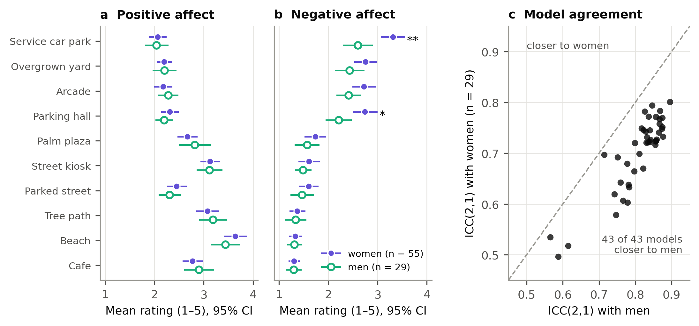

# Supplementary Section S4 — Gender differences (exploratory)

Women (n = 55) and men (n = 29) gave the same positive-affect ratings. Women reported somewhat more negative affect, but only in two environments. Because men rated NA lower, every model agreed more closely with men than with women. Methods are described in Section 2.6. These analyses were not pre-registered.

The men were older than the women (median age 26 vs 24; Mann–Whitney p = .002) and less often from architecture (72% vs 91%; Fisher p = .053). Both variables are controlled for in the adjusted estimates below.

## Participant level

PA did not differ between women and men. PA was equivalent within d = ±0.5, and the Bayes factor favoured no difference (BF₀₁ = 4.2). Women reported higher NA, by 0.24 rating points (g = 0.54). This difference remained after adjusting for age and architecture background. The evidence for it is moderate, not strong (BF₁₀ = 2.6), and the effect lies close to the smallest effect the sample can reliably detect (d = 0.65 at 80% power).

**Table S11 | Women vs men: participant-level PA and NA.**

| Subscale | Women M (SD) | Men M (SD) | Hedges g [95% CI] | p (Holm) | TOST p (d = ±0.5) | BF₁₀ | Adjusted β [95% CI] |
|---|---|---|---|---|---|---|---|
| PA | 2.65 (0.42) | 2.65 (0.44) | 0.00 [−0.46, 0.46] | .989 | .019 | 0.24 | +0.02 [−0.18, 0.21] |
| NA | 2.05 (0.47) | 1.81 (0.35) | 0.54 [0.13, 0.97] | .023 | .584 | 2.60 | +0.22 [0.01, 0.42] |

*One score per participant (mean of 10 environments × 10 items). Welch t-tests; CI of g from a participant bootstrap (2,000 samples). TOST p < .05 supports equivalence. BF₁₀: JZS Bayes factor, Cauchy prior r = 0.707. Adjusted β: linear mixed model with participant random intercepts, adjusted for environment, age and architecture background.*

## Environment level

The gender difference in NA varied across environments (gender × environment, F(9, 738) = 3.71, Greenhouse–Geisser p = .001). For PA it did not (F = 1.00, p = .425). After FDR correction, the NA difference was significant only in the two below-ground service spaces: the Service car park (g = 0.87) and the Parking hall (g = 0.65). Of the 20 PANAS items, only *afraid* was rated differently by women and men after controlling for overall NA (β = +0.21, pFDR = .007). Women therefore reported more fear in these two spaces.

**Table S12 | Women vs men by environment.**

| # | Environment | PA women | PA men | PA g | NA women | NA men | NA g | NA p (FDR) |
|---|---|---|---|---|---|---|---|---|
| 1 | Street kiosk | 3.13 | 3.12 | +0.01 | 1.61 | 1.49 | +0.18 | .503 |
| 2 | Palm plaza | 2.67 | 2.82 | −0.20 | 1.73 | 1.57 | +0.23 | .503 |
| 3 | Overgrown yard | 2.20 | 2.20 | −0.01 | 2.75 | 2.43 | +0.41 | .176 |
| 4 | Parked street | 2.45 | 2.31 | +0.22 | 1.60 | 1.47 | +0.20 | .503 |
| 5 | Arcade | 2.17 | 2.28 | −0.17 | 2.72 | 2.41 | +0.41 | .176 |
| 6 | Tree path | 3.08 | 3.19 | −0.14 | 1.37 | 1.33 | +0.06 | .902 |
| 7 | Beach | 3.64 | 3.44 | +0.25 | 1.33 | 1.31 | +0.05 | .902 |
| 8 | Café | 2.77 | 2.90 | −0.19 | 1.30 | 1.30 | +0.01 | .968 |
| 9 | Service car park | 2.06 | 2.04 | +0.04 | 3.31 | 2.60 | +0.87 | **.002** |
| 10 | Parking hall | 2.31 | 2.20 | +0.21 | 2.74 | 2.21 | +0.65 | **.012** |

*Subscale means per environment; g = Hedges g (women − men). Welch tests with Benjamini–Hochberg FDR correction within each subscale; no PA difference was significant (all pFDR ≥ .72).*

## Model agreement with women and men

All 43 models had a higher ICC(2,1) with men than with women. The mean difference was −0.11, and every model's ratings were also further from women's in absolute error (MAE). Within-item correlation did not differ. The models therefore order the environments in the same way relative to both groups. The gap reflects the level of negative affect: models already rate NA lower than people do (Section 3.2), and men also rate NA lower than women.

**Table S13 | Model agreement with women vs men (mean over 43 models).**

| Index | Difference (women − men) [95% CI] | p | Models closer to women |
|---|---|---|---|
| ICC(2,1) | −0.106 [−0.171, −0.016] | .013 | 0 / 43 |
| Pearson r | −0.079 [−0.120, −0.017] | .013 | 1 / 43 |
| Within-item r | −0.041 [−0.086, +0.040] | .454 | 1 / 43 |
| MAE | +0.129 [+0.020, +0.216] | .022 | 0 / 43 |

*Each model's run-mean ratings were scored against the women's and the men's 200 cell means. Women were subsampled to n = 29 to match the men's reliability. CIs come from a participant bootstrap of both groups (2,000 samples). Results for each model are provided with the data (`T12_gender_vlm_by_model.csv`).*

**Figure S4 | Gender differences in experienced affect and in model agreement.** (a, b) PA and NA means per environment for women (filled, n = 55) and men (hollow, n = 29), with 95% CIs. Environments are sorted by overall human NA. Asterisks mark Welch tests that remain significant after Benjamini–Hochberg FDR correction within each subscale (* p < .05, ** p < .01). (c) ICC(2,1) of each of the 43 models with the men's and with the women's 200 cell means. Women were subsampled to n = 29 so that both groups' means are equally reliable. Points below the dashed identity line agree more with men.
