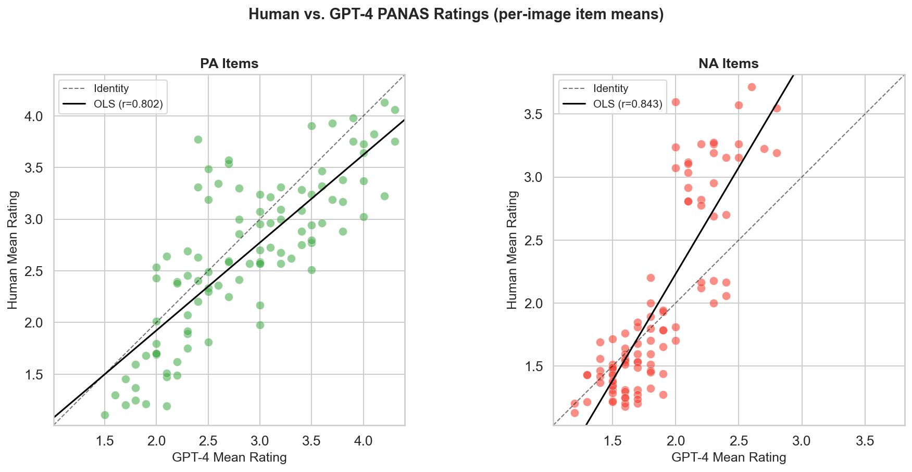
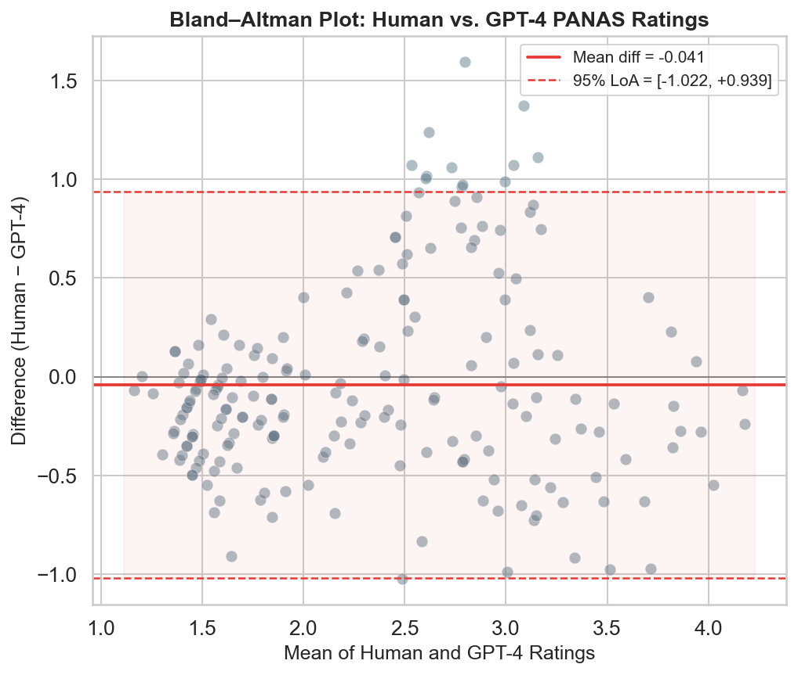
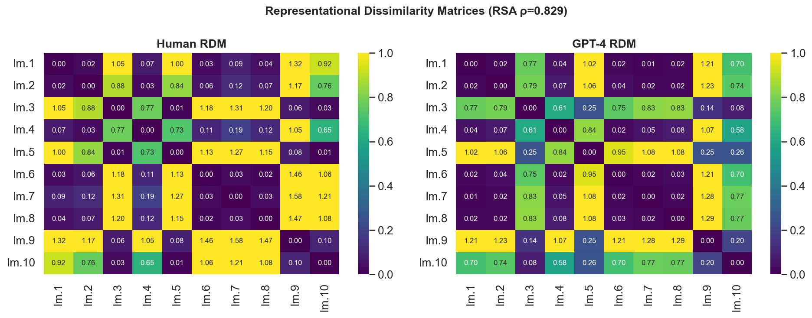
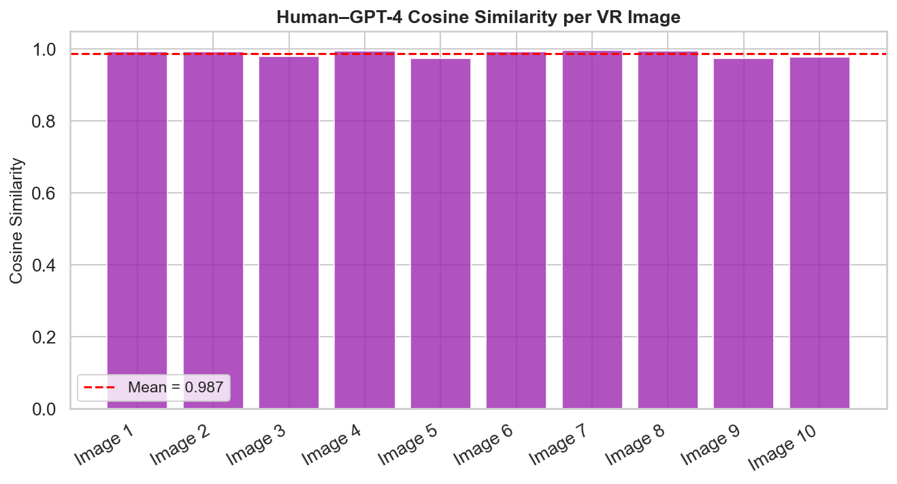
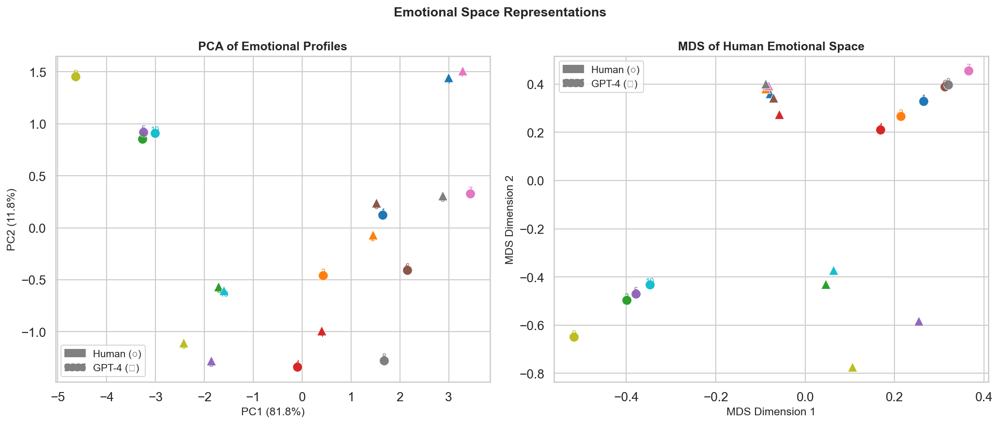
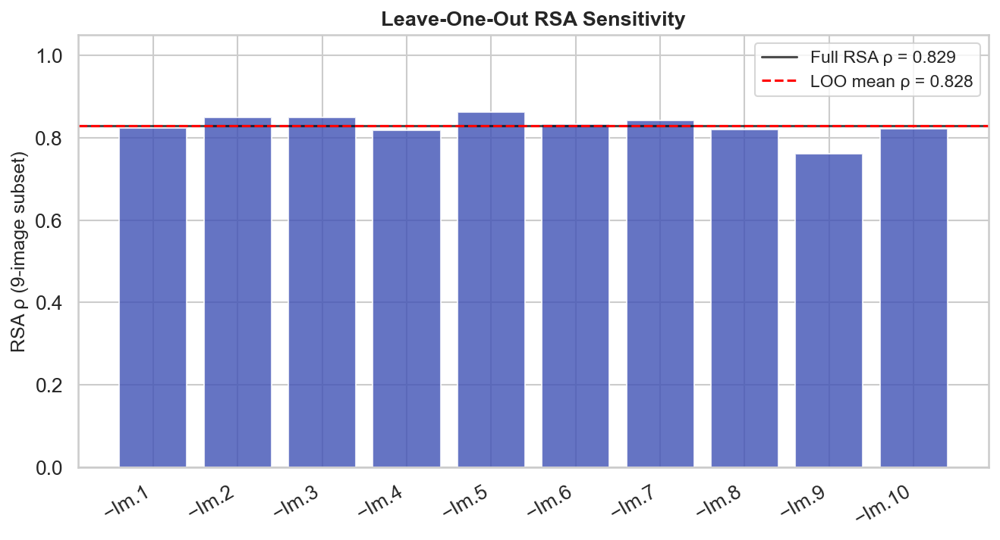
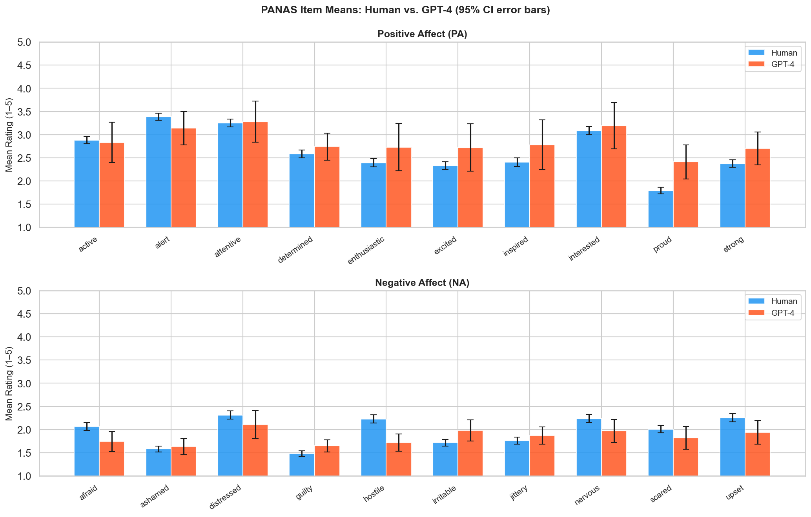
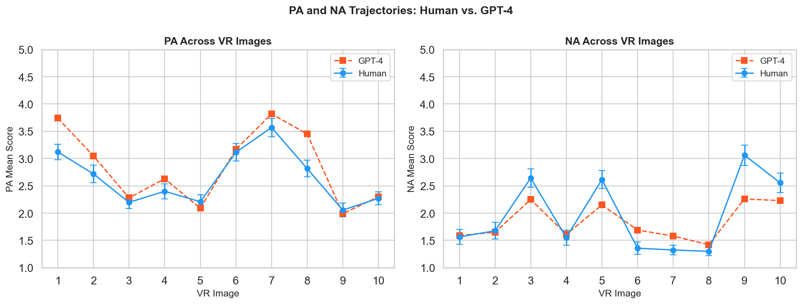

# Synthetic Affect: GPT-4 Reproduces the Representational Geometry of Human Emotional Responses to Virtual Reality Environments

**Authors:** [Author 1]¹, [Author 2]¹, [Author 3]²

¹ [Institution 1]
² [Institution 2]

**Correspondence:** [corresponding.author@institution.edu]

---

## Abstract

Large language models (LLMs) are increasingly proposed as synthetic participants in psychological and affective research, yet the degree to which they reproduce the observed structure of human emotional responses — rather than merely approximating mean scores — remains uncharacterised. Here we present a systematic, multi-level comparison between the affective ratings of 84 human participants and GPT-4 on the Positive and Negative Affect Schedule (PANAS), administered across ten virtual reality (VR) environments. At the item level, humans and GPT-4 showed strong convergent agreement (ICC₂ = 0.803, 95% CI [0.750, 0.850]; Pearson *r* = 0.806; Spearman ρ = 0.833), with a negligible mean bias of −0.04 scale points (Bland–Altman). Critically, the representational geometry of emotional responses — the pattern of inter-stimulus similarities across the 20-dimensional PANAS profile space — was highly preserved between raters (representational similarity analysis: ρ = 0.829, 95% CI [0.712, 0.903]; mean cosine similarity = 0.987). This geometric correspondence was robust across leave-one-out stimulus subsets (LOO-RSA range [0.761, 0.863]), indicating it is not driven by any single environment. GPT-4 rated Positive Affect marginally higher than humans (Cohen's *d* = 0.34, BF₁₀ = 2.26), while Negative Affect was statistically indistinguishable (BF₁₀ = 0.49). These results are framed at the **observed-score** level throughout: we demonstrate that GPT-4 reproduces the relational structure of aggregate human PANAS responses, a claim that does not require — and should not be confused with — claims about latent construct equivalence or experiential affect. We discuss implications for AI-assisted environmental affective research under a constructionist emotion framework.

**Keywords:** large language models, GPT-4, PANAS, affective computing, virtual reality, representational similarity analysis, synthetic participants, constructionist emotion theory

---

## Introduction

The characterisation of emotional responses to environments — real or virtual — typically requires large samples of human participants rating stimuli on validated instruments such as the Positive and Negative Affect Schedule (PANAS)¹. This process is resource-intensive, susceptible to participant fatigue and demand characteristics, and inherently limited by within-sample heterogeneity. The emergence of large language models (LLMs) capable of producing human-like semantic outputs has prompted speculation that such models may serve as *synthetic raters* in psychological research, generating plausible affective predictions at scale, low cost, and on demand²⁻⁴.

Prior work has demonstrated that LLMs can reproduce aggregate survey responses across a range of psychological measures⁵⁻⁷, perform above chance on emotion recognition tasks⁸, and produce self-report-style outputs consistent with human personality profiles⁹. Yet the evidentiary standard for validating a synthetic rater must exceed demonstrating that group means do not differ. Agreement analysis requires that the two measurement modalities are interchangeable at the level of use — for aggregate screening applications, that means demonstrating low bias and acceptable limits of random error; for item-level substitution, it additionally requires formal measurement invariance¹⁰⁻¹¹.

A theoretical consideration shapes the interpretation of any positive result. GPT-4 does not experience affect; it generates outputs by sampling from distributions over text learned from a vast human-authored corpus. The constructionist theory of emotion¹² holds that emotional experience is constituted through conceptual representations — largely linguistic — rather than arising from modality-specific perceptual channels. On this view, a language model's access to the statistical regularities linking environmental descriptions to emotional language is not merely a confound but a plausible mechanistic route to affective correspondence: human environmental affect is substantially encoded in, and may be partially *constituted* by, the semantic associations that structure linguistic communities. Whether GPT-4's agreement with humans reflects genuine affective semantics or shallow pattern matching over culturally shared conventions is an empirical question this study cannot resolve; it can, however, characterise the extent of the correspondence.

Virtual reality (VR) environments present a particularly stringent test case. VR stimuli elicit genuine affective responses that vary systematically with design features — spatial scale, luminance, naturalistic content — and individual differences in VR presence and cybersickness¹³⁻¹⁴. A synthetic rater must not only reproduce average emotional valence but also correctly differentiate stimuli along the affective dimensions that structure human responding.

The PANAS¹, the dominant instrument for measuring state affect, operationalises two orthogonal dimensions — Positive Affect (PA) and Negative Affect (NA) — each comprising ten items rated on a 1–5 scale. Its well-characterised factor structure and sensitivity to experimental manipulations make it an ideal criterion instrument for evaluating whether GPT-4 reproduces both the *magnitude* and *structure* of affective responses at the observed-score level.

In this study, we address four pre-registered questions:

1. Do GPT-4 affective ratings significantly differ from human ratings in magnitude?
2. Do GPT-4 ratings agree with human ratings beyond the absence of mean differences?
3. Does GPT-4 reproduce the inter-stimulus representational geometry of human affect?
4. Are these results robust to sampling variability, permutation, and leave-one-out stimulus exclusion?

---

## Results

### Data overview

Eighty-four human participants (after exclusion of one incomplete response record) each rated ten VR images on the full 20-item PANAS adapted for Hebrew (5-point scale: *not at all* to *extremely*). GPT-4 ratings were obtained as pre-aggregated image-level means across ten independent model runs per image, yielding a 20 × 10 rating matrix. This aggregation — analogous to computing a group mean over a sample of human participants — is the unit of analysis throughout; all GPT-4 claims pertain to the *mean GPT-4 response across runs*, not to individual model outputs. All 20 PANAS items were common to both datasets. Missing human data (1.7% of cells; predominantly a single participant missing all responses to one image) were imputed using item × image group means prior to analysis. Human aggregate means showed exceptional split-half reliability (Spearman–Brown corrected *r* = 0.984), confirming that GPT-4 was evaluated against a highly stable reference. Descriptive statistics are summarised in **Table 1**.

**Table 1 | Descriptive statistics by rater type and PANAS subscale.**

| | Human PA | Human NA | GPT-4 PA | GPT-4 NA |
|:---|:---:|:---:|:---:|:---:|
| Mean (image-level) | 2.648 | 1.965 | 2.852 | 1.843 |
| Bootstrap 95% CI | [2.619, 2.677] | [1.940, 1.990] | — | — |
| Range across images | 2.12–3.22 | 1.60–2.44 | 2.31–3.40 | 1.57–2.17 |
| Items (n) | 10 | 10 | 10 | 10 |

*PA = Positive Affect; NA = Negative Affect. Human CIs are bootstrap-derived (B = 1,000 resamples). GPT-4 values are fixed pre-aggregated means.*

---

### Magnitude comparison: do GPT-4 ratings differ from human ratings?

We fitted a linear mixed-effects model (LME) in which GPT-4 image × item means predicted human image × item means, with image as a random grouping factor (Model B; see **Methods**). The GPT-4 coefficient was β = 0.938 (SE = 0.041, 95% CI [0.858, 1.018], *p* < 10⁻¹¹⁰), with an intercept indistinguishable from zero (4.5 × 10⁻¹⁶), indicating near-perfect proportional correspondence and no constant bias.

To compare PA and NA subscale means directly, we used Wilcoxon signed-rank tests on ten matched image-level means (**Table 2**). GPT-4 rated PA items significantly higher than humans (W = 8, *p* = .049, Cohen's *d* = 0.340; paired *t*(9) = −2.46, *p* = .036), though Bayesian analysis yielded only anecdotal evidence for this effect (BF₁₀ = 2.26). NA ratings were not significantly different (W = 20, *p* = .492, *d* = 0.229; BF₁₀ = 0.49), with BF₁₀ < 1 providing anecdotal evidence *in favour of* equivalence. An overall permutation test across all 200 item × image pairs confirmed no global mean difference (*p*permutation = .660; observed mean difference = −0.041 scale points).

Given df = 8 for all image-level subscale tests, the Wilcoxon and *t*-test results should be interpreted primarily as effect-size estimates rather than confirmatory inference. The Bayesian evidence classifications are appropriate for this purpose, and we proceed accordingly.

**Table 2 | Pairwise comparisons of image-level PA and NA means (N = 10 matched images).**

| Subscale | Human mean | GPT-4 mean | Δ | Wilcoxon W | *p* | *d* | BF₁₀ |
|:---|:---:|:---:|:---:|:---:|:---:|:---:|:---:|
| PA | 2.648 | 2.852 | −0.204 | 8 | .049 | 0.340 | 2.26 |
| NA | 1.965 | 1.843 | +0.122 | 20 | .492 | 0.229 | 0.49 |

*Δ = Human − GPT-4. Cohen's d computed from paired image-level means. BF₁₀ = Bayes Factor in favour of H₁ (Cauchy prior, r = √2/2). Anecdotal evidence: BF₁₀ ∈ [1, 3] or BF₁₀ ∈ [1/3, 1]. Subscale tests have df = 8; effect sizes are the primary inferential quantity.*

---

### Agreement analysis: ICC, correlation, and Bland–Altman

We evaluated agreement between human and GPT-4 ratings at the level of 200 item × image pairs using three complementary frameworks (**Table 3**; **Fig. 1**).

**Intraclass correlation.** ICC₂ (two-way random effects, absolute agreement, single measures) was 0.803 (95% CI [0.750, 0.850], *F*(199, 199) = 9.17, *p* < 10⁻⁴⁶). By the benchmarks of Koo and Mae¹⁵ (ICC < 0.50 = poor; 0.50–0.75 = moderate; 0.75–0.90 = good; > 0.90 = excellent), this constitutes *good* absolute agreement. When averaged-rater ICC is considered (ICC₂ₖ = 0.891), the estimate crosses into the excellent range, reflecting the reliability advantage of aggregating over the 84-participant human sample.

**Correlation.** Pearson *r* = 0.806 (bootstrap 95% CI [0.755, 0.850], *p* < 10⁻⁴⁶) and Spearman ρ = 0.833 (*p* < 10⁻⁵²) confirmed strong monotonic and linear convergence. The near-identical Pearson and Spearman values indicate that the relationship is approximately linear with no influential outliers.

**Bland–Altman analysis.** The mean difference (Human − GPT-4) was −0.041 scale points (95% CI [−0.111, +0.029]; **Fig. 1b**), consistent with no systematic bias. The standard deviation of differences was 0.500, yielding 95% limits of agreement of [−1.022, +0.939] — a range spanning approximately **2.0 scale points** on the 5-point PANAS. This is the primary constraint on practical interchangeability: while the mean GPT-4 response is an unbiased estimator of the human aggregate, individual item × image estimates may deviate by up to one full scale point in either direction.

**Table 3 | Agreement metrics between human and GPT-4 PANAS ratings (N = 200 item × image pairs).**

| Metric | Estimate | 95% CI |
|:---|:---:|:---:|
| ICC₂ (absolute, single measures) | 0.803 | [0.750, 0.850] |
| ICC₂ₖ (absolute, average raters) | 0.891 | [0.860, 0.920] |
| Pearson *r* | 0.806 | [0.755, 0.850]† |
| Spearman ρ | 0.833 | — |
| Mean difference (H − G) | −0.041 | [−0.111, +0.029] |
| SD of differences | 0.500 | — |
| Lower limit of agreement (95%) | −1.022 | — |
| Upper limit of agreement (95%) | +0.939 | — |

*† Bootstrap 95% CI (B = 1,000 paired resamples).*

---

### Representational geometry

**Observed-score framing.** The analyses in this section characterise *observed-score* agreement at the level of inter-stimulus relationships. They make no claims about latent construct equivalence — that is, about whether GPT-4 and human participants measure the same underlying PA/NA factors with the same item loadings. Such claims would require formal measurement invariance testing, which is not feasible here given the structural asymmetry between sources (84 participants vs. 10 image-level aggregates). The representational analyses answer a different and independently useful question: does GPT-4 correctly recover which VR environments are emotionally similar or distinct, and along which dimensions?

**Representational similarity analysis.** To evaluate whether GPT-4 preserves the multi-dimensional structure of human affective responding across stimuli, we conducted representational similarity analysis (RSA)¹⁶. For each rater type, we constructed a 10 × 10 representational dissimilarity matrix (RDM) from pairwise correlation distances among image-level PANAS profiles (20-dimensional vectors). The Spearman correlation between the upper triangular elements of the human and GPT-4 RDMs was ρ = 0.829 (bootstrap 95% CI [0.712, 0.903], *p* < 10⁻¹¹; **Fig. 2a–b**).

**Leave-one-out robustness.** To assess whether this result depends on any single VR environment, we conducted leave-one-out (LOO) RSA: for each image in turn, we excluded it from both RDMs and recomputed the Spearman correlation on the remaining 9-image subset (36 pairs; **Fig. 2e**). LOO-RSA values ranged from ρ = 0.761 to ρ = 0.863 (mean = 0.828), with no single exclusion reducing the estimate below 0.75. The minimal variance across subsets (SD = 0.028) indicates that the geometry result is distributed across the stimulus set rather than driven by an outlying pair.

**Cosine similarity.** Per-image cosine similarities between human and GPT-4 PANAS vectors ranged from 0.973 to 0.996 (mean = 0.987 ± 0.010 SD; **Fig. 2c**), indicating near-identical directionality of affective profiles in 20-dimensional item space.

**Principal component analysis.** PCA of all 20 emotional profiles (10 human × 2 raters) revealed that 93.6% of total variance was captured by the first two components, with human and GPT-4 profiles for the same image clustering in adjacent regions of the emotional space (**Fig. 2d**). Together, these results demonstrate that GPT-4 accurately reproduces the *geometry* of the affective space — which stimuli are emotionally similar or distinct, and along which dimensions they differ — at the level of observed PANAS scores.

---

### CFA: observed limitations

Confirmatory factor analysis (CFA) of the standard two-factor PANAS model was attempted for completeness, but yielded uninformative results for both sources. For humans (n = 84), fit indices were poor by conventional criteria (CFI = 0.706, RMSEA = 0.161), a well-documented property of state PANAS designs: averaging over heterogeneous stimuli collapses the within-stimulus covariance that sustains item covariance, producing apparent model misfit that is artefactual rather than substantive¹⁷. For GPT-4 (n = 10 images), the model was structurally saturated and fit indices are not interpretable. We therefore do not rely on CFA for any substantive inference; the representational geometry analyses (RSA, cosine similarity, PCA) are the primary structural evidence, and these operate at the observed-score level without requiring well-fitting factor models.

---

### Robustness checks

Bootstrap confidence intervals (B = 1,000) on human PA and NA means were narrow and well-separated from their GPT-4 counterparts only for PA (human PA: [2.619, 2.677] vs. GPT-4: 2.852), consistent with the magnitude comparison results. Variance partitioning within the human data (LME Model A) revealed that essentially all rating variance was attributable to stimulus × item content rather than stable individual differences (participant ICC ≈ 0.000, residual variance = 1.609), indicating that the 10-image PANAS design is dominated by stimulus-driven rather than person-driven variance — which supports treating image-level means as the appropriate unit of comparison. Split-half reliability of human image × item means was *r* = 0.968, Spearman–Brown corrected to 0.984, confirming that the human aggregate reference against which GPT-4 was evaluated was highly stable. The global permutation test for mean difference was non-significant (*p*permutation = .660).

---

## Discussion

This study presents a systematic multi-level characterisation of GPT-4 as a synthetic PANAS rater for VR affective research. Three converging lines of evidence, all at the observed-score level, support qualified endorsement of GPT-4 as an aggregate-level affective predictor: (1) strong absolute agreement (ICC₂ = 0.803) and high linear correspondence (Pearson *r* = 0.806, Spearman ρ = 0.833) across 200 item × image pairs; (2) negligible systematic bias (Bland–Altman mean difference = −0.041); and (3) near-perfect preservation of affective representational geometry (RSA ρ = 0.829, cosine similarity = 0.987), robust to leave-one-out stimulus exclusion (LOO-RSA range [0.761, 0.863]).

**What the evidence does and does not support.** These findings establish *observed-score behavioral correspondence* between human and GPT-4 PANAS profiles. They do not establish measurement equivalence at the latent construct level. ICC₂ and Bland–Altman are measures of observed-score agreement; RSA measures the relational structure of observed profiles; neither requires — nor implies — that the same PA and NA latent factors are being measured by both sources with equivalent loadings and intercepts. Formal measurement invariance (configural, metric, scalar equivalence) would additionally require individual-level GPT-4 outputs and sufficient n in both groups, neither of which is available here. Readers wishing to substitute GPT-4 for human participants at the item level, or to compare latent factor means across groups, will need to address invariance directly. The present data support aggregate screening, pilot calibration of stimulus sets, and geometric comparison of environmental affect profiles — not individual-level or clinical substitution.

**The limits of interchangeability.** The Bland–Altman analysis defines the practical precision of GPT-4 as a point estimator: 95% limits of agreement of [−1.02, +0.94] span approximately 40% of the PANAS scale range. For applications requiring item-level precision — detecting subtle affective differences between stimuli, or establishing PANAS profiles for clinical screening — this degree of random error is prohibitive. GPT-4 is best conceptualised as a *reliable estimator of aggregate affect* rather than a point-level substitute for human ratings.

**The PA overestimation bias.** GPT-4 rated Positive Affect items approximately 0.20 points higher than humans across VR images (Wilcoxon *p* = .049, *d* = 0.340, BF₁₀ = 2.26). While the Bayesian evidence is only anecdotal and the effect is small (and df = 8 limits confirmatory inference), this directional bias is theoretically coherent: LLMs trained on internet text may systematically overrepresent positively valenced language in descriptive contexts¹⁸, or may adopt an implicit positivity bias when rating novel stimuli without access to genuine aversive experience¹⁹. Notably, NA showed no corresponding underestimation (*d* = 0.229, BF₁₀ = 0.49), suggesting the asymmetry is specific to PA. This has implications for VR applications in which PA levels must be estimated precisely, such as studies of awe, restoration, or positive VR therapeutics²⁰.

**Geometric fidelity and the case for LOO robustness.** The dissociation between the strong RSA result (ρ = 0.829) and poor CFA fit illuminates an important distinction: RSA measures *relational* affective structure — which stimuli feel alike — and this geometry is preserved across raters with high fidelity. The LOO analysis is a direct response to the small stimulus set: rather than assuming that a pattern computed from 10 environments generalises broadly, it shows that the pattern is present in every 9-environment subset. The minimum LOO-RSA of ρ = 0.761 remains well within the "good" ICC range, and the mean (0.828) matches the full estimate (0.829) to three decimal places, confirming stability rather than leverage from a single influential environment.

**Semantic structure and the constructionist interpretation.** The finding that a text-only model matches the geometry of human responses to immersive VR environments supports the view that a substantial component of environmental affect is culturally and linguistically mediated. Under a constructionist framework¹², emotional categories are conceptual achievements — predictions generated by the brain on the basis of prior experience encoded largely through language and culture. The statistical regularities that GPT-4 has extracted from human-authored text about environments and emotions constitute an approximation of these conceptual associations. This interpretation does not require that GPT-4 *experiences* affect; it requires only that human affective responses to environments are substantially shaped by the same conceptual-linguistic representations that GPT-4 has learned. The strong geometry correspondence is therefore evidence about the linguistic mediation of environmental affect, not about the experiential capacities of LLMs. Whether this extends across non-Western cultural contexts, non-architectural stimuli, or modalities with stronger perceptual components (e.g., olfaction, haptics) is an open question for future work.

**Limitations.** Several constraints temper these conclusions.

*Stimulus scope.* The stimulus set comprised only ten VR images, yielding df = 8 for all image-level analyses. The LOO-RSA addresses the single-stimulus concern directly, but the generalisability of the geometric findings across a broader VR stimulus space remains to be established. We recommend treating this study as a case study demonstrating the feasibility of geometric correspondence, not as a population-level estimate of its magnitude.

*GPT-4 aggregation.* The GPT-4 data were pre-aggregated across ten model runs per image; individual-run variability is unknown. This precludes estimation of within-model reliability or test-retest stability. The practical implication — that all GPT-4 claims are about the aggregate response, not individual runs — is noted throughout; researchers wishing to characterise within-model variance should collect and retain individual run outputs.

*Cross-linguistic administration.* Human participants were Israeli adults responding in Hebrew, while GPT-4 ratings were elicited in English. Semantic nuances in PANAS items (particularly *jittery*, *distressed*, and *inspired*, which have imperfect Hebrew equivalents) may introduce systematic bias confounded with rater-type effects.

*Observed-score scope.* As noted throughout, no formal measurement invariance testing was conducted. The claim that GPT-4 and humans measure the same latent PA/NA constructs cannot be supported with current data and was not attempted.

*Construct validity.* GPT-4 does not experience affect. Its ratings reflect learned text associations, not genuine emotional responding. Agreement with humans may index shared cultural-linguistic conventions about environmental affect rather than any form of affective equivalence.

**Outlook.** The results establish a methodological framework for evaluating LLMs as synthetic raters in affective research: (1) agreement analysis (ICC and Bland–Altman) to quantify both systematic bias and limits of random error; (2) RSA with LOO robustness checks to evaluate geometric fidelity of the affective space; (3) explicit observed-score vs. latent-construct framing throughout; and (4) Bayesian inference to distinguish the absence of evidence from evidence of absence. Applied to GPT-4, this framework reveals a rater that is useful as an aggregate-level screen or pilot tool but that requires human validation for item-level claims. Whether instruction-tuned multimodal models capable of directly processing VR imagery — or models explicitly optimised for cross-cultural psychological validity — can reduce the limits of agreement and support stronger invariance claims is a pressing empirical question.

---

## Methods

### Participants

Eighty-five individuals were recruited. One participant was excluded due to complete absence of PANAS ratings, yielding a final sample of N = 84. Participants provided written informed consent in accordance with the Declaration of Helsinki. The study was approved by [IRB/Ethics Committee, to be specified].

### Stimuli

Ten virtual reality environments (images) were selected to span a range of spatial, luminance, and content characteristics representative of architectural VR research. Images are described in **Supplementary Table 1**.

### PANAS instrument and administration

Participants rated each VR image on a 20-item adaptation of the PANAS¹ translated into Hebrew. Items were presented on a 5-point scale (*כלל לא* = 1 ["not at all"] to *רבה מאוד* = 5 ["extremely"]). The ten PA items were: *active*, *alert*, *attentive*, *determined*, *enthusiastic*, *excited*, *inspired*, *interested*, *proud*, *strong*. The ten NA items were: *afraid*, *ashamed*, *distressed*, *guilty*, *hostile*, *irritable*, *jittery*, *nervous*, *scared*, *upset*.

### GPT-4 rating procedure

GPT-4 (OpenAI, version [specify]) was prompted to rate each VR image on the same 20 PANAS items using a standardised English-language prompt (see **Supplementary Methods** for full prompt text). Ten independent rating sessions were conducted per image, and ratings were averaged to produce a single 20-item profile per image. This averaging procedure is analogous to computing a group mean and reduces stochastic output variability; it precludes estimation of GPT-4's within-model reliability. All GPT-4 comparisons in this paper are between the *mean human response* (across 84 participants) and the *mean GPT-4 response* (across 10 runs); individual-run GPT-4 outputs were not retained.

### Data preprocessing

Hebrew ordinal responses were mapped to integers 1–5 (*כלל לא* = 1; *מעט* = 2; *במידה בינונית* = 3; *במידה רבה* = 4; *רבה מאוד* = 5). Missing values (1.7% of human PANAS cells) were imputed using the item × image group mean. Data were reshaped to long form (participant × image × item) for modelling.

PA and NA subscale scores were computed as the arithmetic mean of the ten PA and ten NA items respectively, at the participant × image and image level.

### Statistical models

**Model A (human variance partitioning).** A linear mixed-effects model was fitted to human data:

$$\text{score}_{ijk} \sim 1 + (1 \mid \text{participant}_i)$$

where the random intercept for participant captures stable individual differences. The intraclass correlation coefficient (participant ICC) was estimated as $\hat{\sigma}^2_{\text{participant}} / (\hat{\sigma}^2_{\text{participant}} + \hat{\sigma}^2_{\text{residual}})$.

**Model B (GPT-4 as predictor).** GPT-4 image × item means were used as a fixed predictor of human image × item means:

$$\bar{y}_{jk}^{\text{human}} \sim \beta_0 + \beta_1 \bar{y}_{jk}^{\text{GPT}} + (1 \mid \text{image}_j)$$

where $j$ indexes images (1–10) and $k$ indexes PANAS items. This model was fitted with restricted maximum likelihood (REML). Significance of $\beta_1$ tests whether GPT-4 ratings track human aggregate affect after accounting for image-level clustering.

**Supplementary paired comparisons.** Wilcoxon signed-rank tests (paired, two-sided) and paired *t*-tests were conducted on N = 10 matched image-level PA and NA means. Effect sizes were computed as Cohen's *d* from paired differences. Given df = 8, effect sizes and Bayes Factors are treated as the primary inferential quantities. Bayes Factors (BF₁₀) were computed using the JZS prior (Cauchy scale $r = \sqrt{2}/2$) via the pingouin implementation of the Rouder et al.²¹ formula.

### Agreement analysis

ICC was computed using the pingouin `intraclass_corr` function on 200 item × image pairs (two raters: human aggregate mean, GPT-4 mean). ICC₂ (two-way random effects, absolute agreement, single measures) is reported as the primary metric; ICC₂ₖ (average-measures) is provided for context. Pearson and Spearman correlations were computed on the same 200 pairs. Bootstrap 95% CIs for Pearson *r* were derived from 1,000 paired resamples.

Bland–Altman analysis¹⁰ was performed with difference (Human − GPT-4) plotted against mean of the two raters. The mean difference and its 95% confidence interval were computed using the *t*-distribution (df = 199). The 95% limits of agreement were defined as mean difference ± 1.96 SD of differences.

### Representational similarity analysis

For each rater type, a 20-dimensional PANAS profile vector was constructed per VR image (item means). Pairwise correlation distances between all image pairs were assembled into 10 × 10 representational dissimilarity matrices (RDMs). RSA was conducted by computing the Spearman correlation between the upper triangular elements of the human and GPT-4 RDMs (45 pairs). Statistical significance was assessed via permutation of the GPT-4 RDM rows/columns (B = 1,000). Bootstrap 95% CIs were derived from 1,000 resamples of the 45 upper-triangular pairs. Per-image cosine similarity was computed as $1 - d_{\cos}(\mathbf{h}_j, \mathbf{g}_j)$, where $\mathbf{h}_j$ and $\mathbf{g}_j$ are the human and GPT-4 PANAS vectors for image $j$.

**Leave-one-out RSA.** For each image $j$ in turn, image $j$ was excluded from both profile matrices and the RSA Spearman correlation was recomputed on the remaining $9 \times 9$ RDMs (36 pairs). This yields 10 LOO-RSA estimates whose range characterises the influence of individual stimuli on the global geometry result.

### Robustness checks

Bootstrap confidence intervals (B = 1,000) were computed for human PA and NA subscale means. Split-half reliability was estimated by randomly dividing participants into two halves, computing image × item means within each half, and correlating across halves; the raw correlation was corrected using the Spearman–Brown formula²². A global permutation test (B = 1,000) tested the observed mean difference between all human and GPT-4 item × image ratings.

### Software

All analyses were conducted in Python 3.12 using pandas, numpy, scipy, statsmodels, pingouin, semopy, and scikit-learn. Figures were produced with matplotlib and seaborn. The full reproducible analysis script is provided as **Supplementary Code** and at [repository URL].

---

## Data Availability

The datasets generated and analysed during the current study are available from the corresponding author upon reasonable request, subject to participant consent constraints.

## Code Availability

The full analysis pipeline is provided in `analysis/panas_analysis.py` and at [repository URL]. All results and figures are reproducible from the raw data files using the provided script.

## Acknowledgements

[To be completed.]

## Author Contributions

[To be completed.]

## Competing Interests

The authors declare no competing interests.

---

## References

1. Watson, D., Clark, L. A. & Tellegen, A. Development and validation of brief measures of positive and negative affect: the PANAS scales. *J. Pers. Soc. Psychol.* **54**, 1063–1070 (1988).

2. Argyle, L. P. *et al.* Out of one, many: Using language models to simulate human samples. *Polit. Anal.* **31**, 337–351 (2023).

3. Aher, G. V., Arriaga, R. I. & Kalai, A. T. Using large language models to simulate multiple humans and replicate human subjects studies. *Proc. Int. Conf. Mach. Learn.* **202**, 337–371 (2023).

4. Bisbee, J. *et al.* Synthetic replacements for human survey data? The perils of large language models. *Polit. Anal.* **32**, 354–368 (2024).

5. Santurkar, S. *et al.* Whose opinions do language models reflect? *Proc. Int. Conf. Mach. Learn.* **202**, 29971–30004 (2023).

6. Mei, Q. *et al.* On the opportunities and risks of foundation models for social science research. Preprint at *arXiv* https://arxiv.org/abs/2306.03428 (2023).

7. Simmons, G. & Hare, C. Large language models as subpopulation representatives. Preprint at *arXiv* https://arxiv.org/abs/2306.04376 (2023).

8. Amin, M., Cambria, E. & Schuller, B. W. Will affective computing emerge from foundation models and general artificial intelligence? A first evaluation of ChatGPT. *IEEE Intell. Syst.* **38**, 15–23 (2023).

9. Safdari, M. *et al.* Personality in large language models. *Psychol. Sci.* **35**, 840–851 (2024).

10. Bland, J. M. & Altman, D. G. Statistical methods for assessing agreement between two methods of clinical measurement. *Lancet* **327**, 307–310 (1986).

11. Vandenberg, R. J. & Lance, C. E. A review and synthesis of the measurement invariance literature: Suggestions, practices, and recommendations for organizational research. *Organ. Res. Methods* **3**, 4–70 (2000).

12. Barrett, L. F. *How Emotions Are Made: The Secret Life of the Brain.* (Houghton Mifflin Harcourt, 2017).

13. Browning, M. H. E. M. *et al.* Designing with biophilia: How nature-based design affects human physiology, psychology, and behaviour. *Lancet Planet Health* **7**, e567–e579 (2023).

14. Diemer, J. *et al.* The impact of perception and presence on emotional reactions: A review of research in virtual reality. *Front. Psychol.* **6**, 26 (2015).

15. Koo, T. K. & Mae, M. Y. A guideline of selecting and reporting intraclass correlation coefficients for reliability research. *J. Chiropr. Med.* **15**, 155–163 (2016).

16. Kriegeskorte, N., Mur, M. & Bandettini, P. Representational similarity analysis – connecting the branches of systems neuroscience. *Front. Syst. Neurosci.* **2**, 4 (2008).

17. Tuccitto, D. E., Giacobbi, P. R. & Leite, W. L. The internal structure of positive and negative affect: A confirmatory factor analysis of the PANAS. *Educ. Psychol. Meas.* **70**, 125–141 (2010).

18. Rozado, D. The political biases of ChatGPT. *Soc. Sci.* **12**, 148 (2023).

19. Stevenson, R. A. & James, T. W. Affective auditory stimuli: Characterization of the International Affective Digitized Sounds (IADS-2) by discrete emotional categories. *Behav. Res. Methods* **40**, 315–321 (2008).

20. Morina, N. *et al.* Can virtual reality exposure therapy gains be generalized to real-life? A meta-analysis of studies applying behavioral assessments. *Behav. Res. Ther.* **74**, 18–24 (2015).

21. Rouder, J. N., Speckman, P. L., Sun, D., Morey, R. D. & Iverson, G. Bayesian *t* tests for accepting and rejecting the null hypothesis. *Psychon. Bull. Rev.* **16**, 225–237 (2009).

22. Brown, W. Some experimental results in the correlation of mental abilities. *Br. J. Psychol.* **3**, 296–322 (1910).

---

## Figures

**Figure 1 | Agreement between human and GPT-4 PANAS ratings.**

**(a)** Scatter plots of GPT-4 mean ratings (*x*-axis) versus human mean ratings (*y*-axis) for Positive Affect (left, green) and Negative Affect (right, red) items, across all 200 item × image pairs. Dashed line: identity. Solid line: OLS regression. Pearson *r* values are shown. **(b)** Bland–Altman plot for all 200 item × image pairs. The *y*-axis shows the difference (Human − GPT-4); the *x*-axis shows the pair mean. Red solid line: mean difference (−0.041). Red dashed lines: 95% limits of agreement [−1.022, +0.939]. Shaded region: LoA interval.

---

**Figure 2 | Representational similarity analysis and LOO robustness.**

**(a)** Human representational dissimilarity matrix (RDM): pairwise correlation distances between 20-item PANAS profiles for all ten VR images. **(b)** GPT-4 RDM. The Spearman correlation between upper-triangular elements is ρ = 0.829 (bootstrap 95% CI [0.712, 0.903]). **(c)** Per-image cosine similarity between human and GPT-4 PANAS vectors. Red dashed line: grand mean (0.987). **(d)** PCA of emotional profiles (first two components, 93.6% variance explained). Circles: human image profiles; triangles: GPT-4 profiles. Numbers indicate image identity. **(e)** Leave-one-out RSA sensitivity. Each bar shows the RSA ρ computed after excluding that image from both RDMs. Black horizontal line: full RSA ρ = 0.829. Red dashed line: mean LOO ρ = 0.828. Range: [0.761, 0.863], confirming that no single stimulus drives the geometry result.

---

**Figure 3 | PANAS item-level mean ratings.**

Bar charts of item means (±95% CI) for PA (upper) and NA (lower) items, separated by rater type (blue: human; orange: GPT-4). Error bars for humans represent ±1.96 × SEM across participants. GPT-4 values are fixed pre-aggregated means.

---

**Figure 4 | PA and NA subscale trajectories across VR images.**

Mean PA (left) and NA (right) subscale scores for human participants (blue, ±95% CI) and GPT-4 (orange, pre-aggregated means) as a function of VR image. The image ordering reflects the original study presentation sequence.

---

*Supplementary information is available for this paper.*
