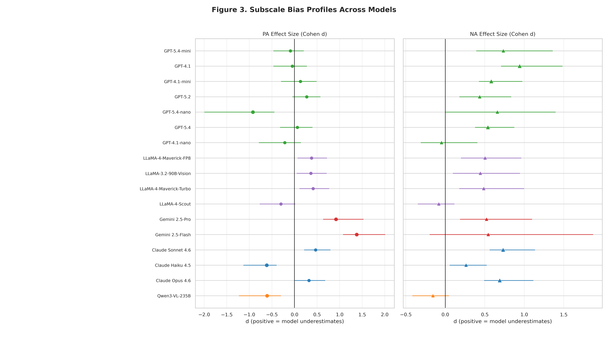
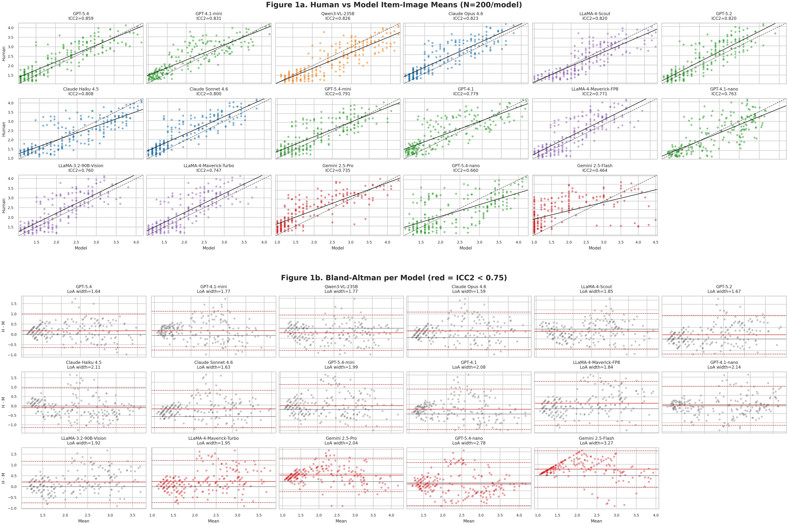
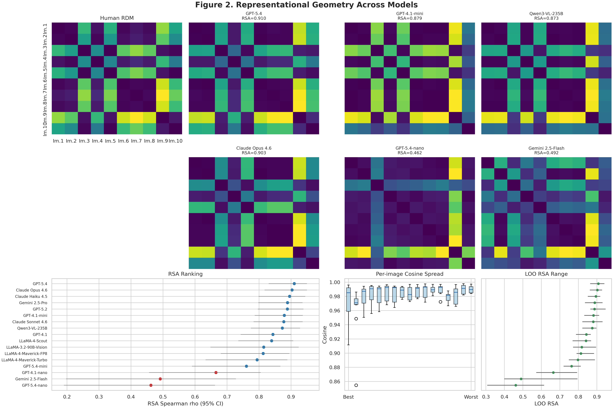
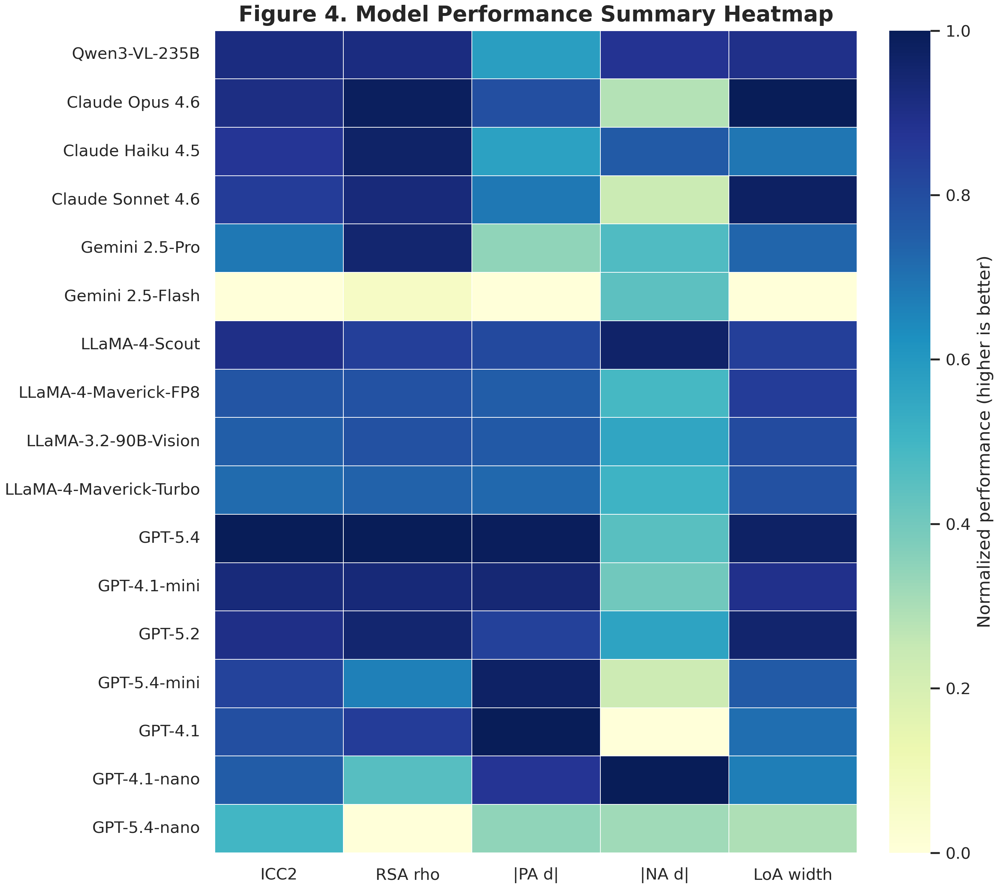

# Synthetic Affect: Benchmarking Seventeen Visual Language Models as PANAS Raters for Virtual Reality Architectural Environments

**Authors:** [Author 1]¹, [Author 2]¹, [Author 3]²

¹ [Institution 1]
² [Institution 2]

**Correspondence:** [corresponding.author@institution.edu]

---

## Abstract

Large language models (LLMs) are increasingly proposed as synthetic participants in psychological and affective research, yet systematic comparisons across model families at scale remain scarce. Here we present a benchmark evaluation of seventeen visual language models (VLMs) — spanning five model families (Anthropic Claude, Google Gemini, OpenAI GPT-4.1, OpenAI GPT-5, Meta LLaMA, and Alibaba Qwen) and multiple capability tiers — as synthetic raters on the Positive and Negative Affect Schedule (PANAS), benchmarked against 84 human participants rating ten virtual reality (VR) architectural environments. One additional model (LLaMA-3.2-11B-Vision) failed to produce usable responses. Fourteen of seventeen models achieved *good* absolute agreement (ICC₂ ≥ 0.75) with human ratings. GPT-5.4 achieved the strongest overall profile (ICC₂ = 0.859, RSA ρ = 0.910), while Claude Opus 4.6 showed the narrowest limits of agreement (Bland–Altman width = 1.59 scale points) and highest geometric fidelity among Claude models (RSA ρ = 0.903). Two conspicuous outliers emerged: Gemini-2.5-Flash (ICC₂ = 0.464, RSA ρ = 0.492) and GPT-5.4-nano (ICC₂ = 0.660, RSA ρ = 0.462), both exhibiting poor representational geometry. The inter-stimulus relational structure of human affective responses was highly preserved in thirteen of seventeen models (RSA ρ ≥ 0.813), indicating that most VLMs correctly recover which environments are emotionally similar or distinct. A systematic negative affect (NA) underestimation bias was prevalent across nine models (Cohen's *d* range: 0.44–0.94), yet three models — LLaMA-4-Scout, Qwen3-VL-235B, and GPT-4.1-nano — showed negligible bias on both PA and NA subscales. These results establish a cross-family benchmarking framework for VLM synthetic raters in affective research and reveal that model capability tier, training family, and subscale-specific biases must all be considered when selecting models for aggregate affective screening in architectural design.

**Keywords:** visual language models, PANAS, affective computing, virtual reality, representational similarity analysis, synthetic participants, model comparison, architectural experience, constructionist emotion theory

---

## Introduction

The characterisation of emotional responses to environments — real or virtual — typically requires large samples of human participants rating stimuli on validated instruments such as the Positive and Negative Affect Schedule (PANAS)¹. This process is resource-intensive, susceptible to participant fatigue and demand characteristics, and inherently limited by within-sample heterogeneity. The emergence of large language models (LLMs) capable of producing human-like semantic outputs has prompted speculation that such models may serve as *synthetic raters* in psychological research, generating plausible affective predictions at scale, low cost, and on demand²⁻⁴.

Architectural design presents a particular domain of interest. Spaces are evaluated and communicated through qualitative, affect-laden descriptors — "cozy," "unsettling," "inspiring" — yet the subjective nature of these responses lacks standardised metrics, leaving architects reliant on anecdotal feedback or post-occupancy surveys⁵. If VLMs can reliably reproduce the aggregate affective responses that humans report to architectural environments, they could be embedded in design workflows as synthetic evaluators, enabling rapid iterative screening of designs before human studies are conducted⁶⁻⁸. The concept of "synthetic humans" — AI entities that can simulate user responses during the design process — depends critically on this empirical validation⁹⁻¹⁰.

Prior work has demonstrated that LLMs can reproduce aggregate survey responses across a range of psychological measures¹¹⁻¹³, perform above chance on emotion recognition tasks¹⁴, and produce self-report-style outputs consistent with human personality profiles¹⁵. However, validation standards for synthetic raters must exceed showing that group means do not differ. Agreement analysis requires that two measurement modalities are interchangeable at the level of use: for aggregate screening, this means demonstrating low bias and acceptable random error; for item-level substitution, it additionally requires formal measurement invariance¹⁶⁻¹⁷.

A theoretical consideration shapes the interpretation of any positive result. VLMs do not experience affect; they generate outputs by sampling from distributions over text and images learned from vast human-authored corpora. The constructionist theory of emotion¹⁸ holds that emotional experience is constituted through conceptual representations — largely linguistic — rather than arising from modality-specific perceptual channels. On this view, a model's access to the statistical regularities linking environmental descriptions to emotional language is a plausible mechanistic route to affective correspondence: human environmental affect is substantially encoded in the semantic associations that structure linguistic communities¹⁹. Whether VLM agreement with humans reflects genuine affective semantics or shallow pattern matching over culturally shared conventions is an empirical question this study cannot resolve; it can, however, systematically characterise the extent and consistency of the correspondence across five model families.

Virtual reality (VR) architectural environments present a particularly stringent test case. VR stimuli elicit genuine affective responses that vary systematically with design features — spatial scale, luminance, naturalistic versus artificial content — and individual differences in presence and cybersickness²⁰⁻²¹. A synthetic rater must not only reproduce average emotional valence but also correctly differentiate stimuli along the affective dimensions that structure human responding.

The PANAS¹, the dominant instrument for measuring state affect, operationalises two orthogonal dimensions — Positive Affect (PA) and Negative Affect (NA) — each comprising ten items rated on a 1–5 scale. Its well-characterised factor structure and sensitivity to experimental manipulations make it an ideal criterion instrument for evaluating whether VLMs reproduce both the *magnitude* and *structure* of affective responses.

Previous single-model evaluations have demonstrated promising but qualified correspondence between individual VLMs and human raters for architectural stimuli⁶⁻⁷. However, comparisons across model families and capability tiers at scale remain absent from the literature, leaving open the question of whether observed correspondence reflects a property of the VLM class broadly or depends critically on architectural and training choices. In this study, we address this gap by evaluating seventeen VLMs — three Anthropic Claude models (Haiku 4.5, Sonnet 4.6, Opus 4.6), two Google Gemini models (2.5-Flash, 2.5-Pro), three OpenAI GPT-4.1 models (GPT-4.1, GPT-4.1-mini, GPT-4.1-nano), four OpenAI GPT-5 models (GPT-5.2, GPT-5.4, GPT-5.4-mini, GPT-5.4-nano), four Meta LLaMA models (LLaMA-3.2-90B-Vision, LLaMA-4-Maverick-FP8, LLaMA-4-Maverick-Turbo, LLaMA-4-Scout), and one Alibaba Qwen model (Qwen3-VL-235B) — against the same human reference dataset, enabling direct cross-model comparison under controlled conditions. One smaller model (LLaMA-3.2-11B-Vision) failed to produce structured responses and is reported as non-functional.

We address four questions:

1. Do VLM affective ratings differ from human ratings in magnitude, and how does this vary by model family, capability tier, and subscale?
2. Do VLM ratings agree with human ratings beyond the absence of mean differences?
3. Do VLMs reproduce the inter-stimulus representational geometry of human affect?
4. Are these results robust to sampling variability and leave-one-out stimulus exclusion?

---

## Results

### Data overview

Eighty-four human participants (after exclusion of one incomplete response record) each rated ten VR architectural images on the full 20-item PANAS adapted for Hebrew (5-point scale: *not at all* to *extremely*). For each VLM, ratings were obtained as pre-aggregated image-level means across ten independent model runs per image, yielding a 20 × 10 rating matrix per model. This aggregation — analogous to computing a group mean over a sample of human participants — is the unit of analysis throughout; all VLM claims pertain to the *mean response across runs*, not to individual model outputs. All 20 PANAS items were common to both datasets. Missing human data (1.7% of cells; predominantly a single participant missing all responses to one image) were imputed using item × image group means prior to analysis. Human aggregate means showed exceptional split-half reliability (Spearman–Brown corrected *r* = 0.984), confirming that VLMs were evaluated against a highly stable reference.

**Table 1 | PA and NA means by model (N = 10 images each).**

| Model | Family | PA mean | NA mean | BA mean diff (H − M) |
|:---|:---:|:---:|:---:|:---:|
| Human | — | 2.648 | 1.965 | — |
| Claude Haiku 4.5 | Anthropic | 2.996 | 1.801 | −0.092 |
| Claude Sonnet 4.6 | Anthropic | 2.405 | 1.544 | +0.332 |
| Claude Opus 4.6 | Anthropic | 2.473 | 1.571 | +0.284 |
| Gemini 2.5-Flash | Google | 1.920 | 1.552 | +0.570 |
| Gemini 2.5-Pro | Google | 2.175 | 1.631 | +0.403 |
| GPT-4.1 | OpenAI | 2.678 | 1.453 | +0.241 |
| GPT-4.1-mini | OpenAI | 2.563 | 1.610 | +0.220 |
| GPT-4.1-nano | OpenAI | 2.756 | 2.000 | −0.072 |
| GPT-5.2 | OpenAI | 2.517 | 1.721 | +0.187 |
| GPT-5.4 | OpenAI | 2.612 | 1.648 | +0.176 |
| GPT-5.4-mini | OpenAI | 2.692 | 1.564 | +0.178 |
| GPT-5.4-nano | OpenAI | 3.116 | 1.641 | −0.072 |
| LLaMA-3.2-90B-Vision | Meta | 2.475 | 1.711 | +0.213 |
| LLaMA-4-Maverick-FP8 | Meta | 2.470 | 1.681 | +0.231 |
| LLaMA-4-Maverick-Turbo | Meta | 2.451 | 1.686 | +0.238 |
| LLaMA-4-Scout | Meta | 2.821 | 2.018 | −0.113 |
| Qwen3-VL-235B | Alibaba | 2.986 | 2.070 | −0.222 |

*Bland–Altman mean difference (H − M) is computed across all 200 item × image pairs. Positive values indicate the model rates overall lower than humans; negative values indicate overall overestimation.*

---

### Magnitude comparison: subscale biases across models

We compared PA and NA subscale means on ten matched image-level means per model using Wilcoxon signed-rank tests and Bayesian paired *t*-tests (**Table 2**).

**Negative affect underestimation was prevalent but heterogeneous.** Eight of seventeen models showed moderate-to-very-strong evidence for NA underestimation (BF₁₀ > 3). The strongest NA underestimation was observed in GPT-4.1 (Cohen's *d* = 0.942, BF₁₀ = 57.9), followed by Claude Sonnet 4.6 (d = 0.732, BF₁₀ = 85.0), GPT-5.4-mini (d = 0.735, BF₁₀ = 5.9), Claude Opus 4.6 (d = 0.689, BF₁₀ = 48.0), GPT-5.4 (d = 0.540, BF₁₀ = 33.0), GPT-4.1-mini (d = 0.582, BF₁₀ = 164.7), Gemini 2.5-Pro (d = 0.522, BF₁₀ = 5.0), and LLaMA-4-Maverick-FP8 (d = 0.503, BF₁₀ = 3.53). Critically, three models showed negligible NA bias: GPT-4.1-nano (d = −0.048, BF₁₀ = 0.32), LLaMA-4-Scout (d = −0.082, BF₁₀ = 0.40), and Qwen3-VL-235B (d = −0.156, BF₁₀ = 0.72). Gemini 2.5-Flash showed NA underestimation in direction (d = 0.544) but with inconclusive Bayesian evidence (BF₁₀ = 0.73). LLaMA-3.2-90B-Vision and LLaMA-4-Maverick-Turbo also showed small, inconclusive NA underestimation (d = 0.44–0.49, BF₁₀ = 1.89–2.81).

**Positive affect patterns were model-family-specific.** GPT-4.1 (d = −0.049, BF₁₀ = 0.32), GPT-5.4 (d = 0.063, BF₁₀ = 0.33), GPT-5.4-mini (d = −0.090, BF₁₀ = 0.35), and GPT-4.1-nano (d = −0.216, BF₁₀ = 0.50) all showed small effects with Bayesian support favouring little-to-no difference rather than strong evidence of equivalence. Claude models were divergent within family: Haiku 4.5 overestimated PA (d = −0.615, BF₁₀ = 38.6), while Sonnet 4.6 (d = 0.467, BF₁₀ = 6.9) showed moderate underestimation and Opus 4.6 (d = 0.322, BF₁₀ = 1.30) showed marginal, inconclusive underestimation. Both Gemini models substantially underestimated PA (Flash: d = 1.378, BF₁₀ = 671.2; Pro: d = 0.920, BF₁₀ = 58.4). GPT-5.4-nano showed strong PA overestimation (d = −0.920, BF₁₀ = 33.7; PA mean = 3.116 versus human 2.648), constituting the largest PA deviation of any model. Qwen3-VL-235B showed moderate PA overestimation (d = −0.607, BF₁₀ = 13.1; PA mean = 2.986). LLaMA-4-Scout showed no clear PA bias (d = −0.299, BF₁₀ = 0.87). LLaMA-3.2-90B-Vision and LLaMA-4-Maverick variants showed small, inconclusive PA underestimation (d = 0.36–0.41, BF₁₀ = 1.25–1.68).

**Table 2 | Subscale bias by model: Cohen's *d* and Bayes Factors (N = 10 matched images).**

| Model | PA *d* | PA BF₁₀ | NA *d* | NA BF₁₀ |
|:---|:---:|:---:|:---:|:---:|
| Claude Haiku 4.5 | −0.615** | 38.6 | 0.263 | 1.75 |
| Claude Sonnet 4.6 | 0.467* | 6.89 | 0.732** | 85.0 |
| Claude Opus 4.6 | 0.322 | 1.30 | 0.689** | 48.0 |
| Gemini 2.5-Flash | 1.378** | 671.2 | 0.544 | 0.73 |
| Gemini 2.5-Pro | 0.920** | 58.4 | 0.522* | 5.0 |
| GPT-4.1 | −0.049 | 0.32 | 0.942** | 57.9 |
| GPT-4.1-mini | 0.130 | 0.38 | 0.582** | 164.7 |
| GPT-4.1-nano | −0.216 | 0.50 | −0.048 | 0.32 |
| GPT-5.2 | 0.271 | 0.92 | 0.436 | 2.41 |
| GPT-5.4 | 0.063 | 0.33 | 0.540** | 33.0 |
| GPT-5.4-mini | −0.090 | 0.35 | 0.735* | 5.88 |
| GPT-5.4-nano | −0.920** | 33.7 | 0.658 | 0.99 |
| LLaMA-3.2-90B-Vision | 0.363 | 1.25 | 0.443 | 1.89 |
| LLaMA-4-Maverick-FP8 | 0.378 | 1.59 | 0.503* | 3.53 |
| LLaMA-4-Maverick-Turbo | 0.414 | 1.68 | 0.486 | 2.81 |
| LLaMA-4-Scout | −0.299 | 0.87 | −0.082 | 0.40 |
| Qwen3-VL-235B | −0.607** | 13.1 | −0.156 | 0.72 |

*Positive d = model underestimates (Human > Model); negative d = model overestimates. BF₁₀: anecdotal [1–3], moderate [3–10], strong [10–30], very strong [>30]. \* BF₁₀ > 3; \*\* BF₁₀ > 10. With N = 10 matched images, paired t-tests use df = 9. Effect sizes and Bayes Factors are the primary inferential quantities.*

**Visual summary (subscale bias).** Two-panel forest plot of Cohen's *d* effect sizes for PA (left, circles) and NA (right, triangles), with bootstrap 95% confidence intervals (N = 10 matched images per model). Positive *d* indicates model underestimation relative to humans.

---

### Agreement analysis: ICC, correlation, and Bland–Altman

We evaluated agreement between human and each model's ratings at the level of 200 item × image pairs using three complementary frameworks (**Table 3**).

**Overall agreement hierarchy.** Fourteen of seventeen models achieved ICC₂ ≥ 0.75 (good agreement by Koo and Mae²² benchmarks: ICC < 0.50 = poor; 0.50–0.75 = moderate; 0.75–0.90 = good; > 0.90 = excellent). GPT-5.4 showed the highest ICC₂ (0.859), followed by GPT-4.1-mini (0.831), Qwen3-VL-235B (0.826), Claude Opus 4.6 (0.823), GPT-5.2 (0.820), and LLaMA-4-Scout (0.820). The remaining models in the good range were Claude Haiku 4.5 (0.808), Claude Sonnet 4.6 (0.800), GPT-5.4-mini (0.791), GPT-4.1 (0.779), LLaMA-4-Maverick-FP8 (0.771), GPT-4.1-nano (0.763), LLaMA-3.2-90B-Vision (0.760), and LLaMA-4-Maverick-Turbo (0.747). Gemini 2.5-Pro fell at the boundary of good agreement (ICC₂ = 0.735). GPT-5.4-nano (ICC₂ = 0.660) and Gemini 2.5-Flash (ICC₂ = 0.464) were the only models to fall below this threshold, with Gemini 2.5-Flash reaching the poor range.

**Linear mixed-effects modelling.** For each model, we fitted a linear mixed-effects model (Model B) in which model image × item means predicted human image × item means, with image as a random grouping factor. All models with usable data showed highly significant β coefficients (*p* < 10⁻³¹), with slopes ranging from 0.628 (Gemini 2.5-Flash) to 0.949 (Claude Opus 4.6) and intercepts indistinguishable from zero, confirming proportional rather than offset correspondence. GPT-5.4 (slope = 0.868), LLaMA-4-Scout (slope = 0.886), and Qwen3-VL-235B (slope = 0.858) showed intermediate slopes consistent with moderate global scaling relative to human affect.

**Bland–Altman analysis.** The mean difference (Human − Model) ranged from −0.222 (Qwen3-VL-235B, slight overestimation) to +0.570 (Gemini 2.5-Flash, substantial underestimation). The 95% limits of agreement (LoA) spanned approximately 1.6–3.3 scale points across models. Gemini 2.5-Flash showed the widest LoA (width = 3.27 scale points, spanning 65% of the 5-point PANAS range), reflecting both systematic bias and high random error. GPT-5.4-nano showed the second widest LoA (width = 2.78), driven by its severe PA overestimation. Claude Opus 4.6 showed the narrowest LoA (width = 1.59), indicating the smallest random error, followed closely by GPT-5.4 (width = 1.64), Claude Sonnet 4.6 (width = 1.63), GPT-5.2 (width = 1.67), and Qwen3-VL-235B (width = 1.77).

**Direct pairwise error.** As an intuitive cross-study summary, we also computed mean absolute error (MAE) and root mean squared error (RMSE) between human and model means across the same 200 item × image pairs after normalising PANAS scores to the 0–1 range. GPT-5.4 showed the lowest normalised MAE (0.087), followed by GPT-5.2 (0.088), Claude Opus 4.6 (0.094), GPT-4.1-mini (0.097), LLaMA-4-Scout (0.097), and Qwen3-VL-235B (0.097). The largest direct errors were observed for Gemini 2.5-Flash (MAE = 0.202), GPT-5.4-nano (0.139), and Gemini 2.5-Pro (0.131), matching the broader agreement hierarchy.

**Table 3 | Agreement metrics by model (N = 200 item × image pairs per model).**

| Model | ICC₂ | Pearson *r* | Spearman ρ | MAE (0–1) | RMSE (0–1) | BA mean diff | BA LoA |
|:---|:---:|:---:|:---:|:---:|:---:|:---:|:---:|
| Claude Haiku 4.5 | 0.808 | 0.817 | 0.817 | 0.106 | 0.136 | −0.092 | [−1.148, +0.964] |
| Claude Sonnet 4.6 | 0.800 | 0.868 | 0.879 | 0.101 | 0.133 | +0.332 | [−0.484, +1.147] |
| Claude Opus 4.6 | 0.823 | 0.875 | 0.885 | 0.094 | 0.124 | +0.284 | [−0.510, +1.079] |
| Gemini 2.5-Flash | 0.464 | 0.563 | 0.657 | 0.202 | 0.252 | +0.570 | [−1.065, +2.205] |
| Gemini 2.5-Pro | 0.735 | 0.818 | 0.844 | 0.131 | 0.164 | +0.403 | [−0.615, +1.421] |
| GPT-4.1 | 0.779 | 0.811 | 0.822 | 0.111 | 0.145 | +0.241 | [−0.799, +1.281] |
| GPT-4.1-mini | 0.831 | 0.859 | 0.869 | 0.097 | 0.125 | +0.220 | [−0.665, +1.104] |
| GPT-4.1-nano | 0.763 | 0.767 | 0.776 | 0.103 | 0.138 | −0.072 | [−1.143, +1.000] |
| GPT-5.2 | 0.820 | 0.859 | 0.859 | 0.088 | 0.116 | +0.187 | [−0.645, +1.020] |
| GPT-5.4 | 0.859 | 0.878 | 0.877 | 0.087 | 0.113 | +0.176 | [−0.642, +0.995] |
| GPT-5.4-mini | 0.791 | 0.809 | 0.801 | 0.101 | 0.135 | +0.178 | [−0.819, +1.176] |
| GPT-5.4-nano | 0.660 | 0.663 | 0.642 | 0.139 | 0.178 | −0.072 | [−1.460, +1.316] |
| LLaMA-3.2-90B-Vision | 0.760 | 0.808 | 0.807 | 0.100 | 0.133 | +0.213 | [−0.745, +1.172] |
| LLaMA-4-Maverick-FP8 | 0.771 | 0.824 | 0.823 | 0.098 | 0.131 | +0.231 | [−0.691, +1.152] |
| LLaMA-4-Maverick-Turbo | 0.747 | 0.801 | 0.801 | 0.101 | 0.137 | +0.238 | [−0.736, +1.212] |
| LLaMA-4-Scout | 0.820 | 0.829 | 0.852 | 0.097 | 0.121 | −0.113 | [−1.040, +0.813] |
| Qwen3-VL-235B | 0.826 | 0.854 | 0.844 | 0.097 | 0.125 | −0.222 | [−1.105, +0.661] |

**Visual summary (agreement).** Scatter plots (human vs. model item × image means) and per-model Bland–Altman panels for all seventeen models.

---

### Representational geometry

**Observed-score framing.** The analyses in this section characterise *observed-score* agreement at the level of inter-stimulus relationships. They make no claims about latent construct equivalence — that is, about whether VLMs and human participants measure the same underlying PA/NA factors with the same item loadings. The representational analyses answer a different and independently useful question: does each model correctly recover which VR environments are emotionally similar or distinct, and along which dimensions?

**Representational similarity analysis.** For each model, we constructed a 10 × 10 representational dissimilarity matrix (RDM) from pairwise correlation distances among image-level PANAS profiles (20-dimensional vectors) and computed the Spearman correlation between the upper triangular elements of the human and model RDMs (**Table 4**; RSA²³).

Thirteen models showed strong RSA correspondence (ρ ≥ 0.813). GPT-5.4 achieved the highest geometric fidelity (ρ = 0.910, 95% CI [0.830, 0.950]), followed closely by Claude Opus 4.6 (ρ = 0.903, CI [0.817, 0.950]), Claude Haiku 4.5 (ρ = 0.896, CI [0.799, 0.944]), Gemini 2.5-Pro (ρ = 0.889, CI [0.798, 0.936]), GPT-5.2 (ρ = 0.889, CI [0.796, 0.939]), GPT-4.1-mini (ρ = 0.879, CI [0.787, 0.937]), Claude Sonnet 4.6 (ρ = 0.877, CI [0.783, 0.936]), Qwen3-VL-235B (ρ = 0.873, CI [0.775, 0.928]), LLaMA-4-Scout (ρ = 0.839, CI [0.736, 0.907]), GPT-4.1 (ρ = 0.843, CI [0.743, 0.900]), LLaMA-3.2-90B-Vision (ρ = 0.815, CI [0.648, 0.924]), LLaMA-4-Maverick-FP8 (ρ = 0.813, CI [0.681, 0.895]), and LLaMA-4-Maverick-Turbo (ρ = 0.794, CI [0.633, 0.888]). GPT-5.4-mini showed reduced but statistically significant geometric correspondence (ρ = 0.761, CI [0.590, 0.867]). GPT-4.1-nano (ρ = 0.665, CI [0.457, 0.805]) and GPT-5.4-nano (ρ = 0.462, CI [0.191, 0.662]) showed substantially degraded geometry, with GPT-5.4-nano's geometric failure mirroring Gemini 2.5-Flash (ρ = 0.492, CI [0.197, 0.728]) — both failing to reliably recover the relational structure of human environmental affect.

**Leave-one-out robustness.** LOO-RSA values for the thirteen high-correspondence models ranged from ρ = 0.720 to ρ = 0.947, with all minimum LOO values exceeding 0.720 (GPT-5.4-mini), confirming that geometry results are distributed across the stimulus set rather than driven by single influential environments. For Gemini 2.5-Flash and GPT-5.4-nano, LOO-RSA values collapsed substantially (Gemini 2.5-Flash minimum: 0.399; GPT-5.4-nano minimum: 0.307), indicating that even the modest full-sample correlations are partly artefacts of high-leverage stimulus pairs.

**Cosine similarity.** Per-image cosine similarities between human and model PANAS vectors were high across the thirteen best-performing models (means 0.979–0.990), confirming near-identical directionality of affective profiles in 20-dimensional item space. GPT-5.4 and Claude Opus 4.6 achieved the highest mean cosines (0.990 ± 0.006 each), while Gemini 2.5-Flash showed the lowest (0.960 ± 0.034).

**Table 4 | Representational geometry results by model.**

| Model | RSA ρ | RSA 95% CI | LOO-RSA range | Mean cosine |
|:---|:---:|:---:|:---:|:---:|
| Claude Haiku 4.5 | 0.896 | [0.799, 0.944] | [0.851, 0.918] | 0.982 |
| Claude Sonnet 4.6 | 0.877 | [0.783, 0.936] | [0.821, 0.931] | 0.987 |
| Claude Opus 4.6 | 0.903 | [0.817, 0.950] | [0.862, 0.928] | 0.990 |
| Gemini 2.5-Flash | 0.492 | [0.197, 0.728] | [0.399, 0.795] | 0.960 |
| Gemini 2.5-Pro | 0.889 | [0.798, 0.936] | [0.864, 0.947] | 0.979 |
| GPT-4.1 | 0.843 | [0.743, 0.900] | [0.787, 0.867] | 0.984 |
| GPT-4.1-mini | 0.879 | [0.787, 0.937] | [0.832, 0.912] | 0.989 |
| GPT-4.1-nano | 0.665 | [0.457, 0.805] | [0.572, 0.793] | 0.980 |
| GPT-5.2 | 0.889 | [0.796, 0.939] | [0.836, 0.918] | 0.989 |
| GPT-5.4 | 0.910 | [0.830, 0.950] | [0.864, 0.940] | 0.990 |
| GPT-5.4-mini | 0.761 | [0.590, 0.867] | [0.720, 0.837] | 0.983 |
| GPT-5.4-nano | 0.462 | [0.191, 0.662] | [0.307, 0.597] | 0.968 |
| LLaMA-3.2-90B-Vision | 0.815 | [0.648, 0.924] | [0.771, 0.876] | 0.984 |
| LLaMA-4-Maverick-FP8 | 0.813 | [0.681, 0.895] | [0.790, 0.858] | 0.985 |
| LLaMA-4-Maverick-Turbo | 0.794 | [0.633, 0.888] | [0.749, 0.852] | 0.983 |
| LLaMA-4-Scout | 0.839 | [0.736, 0.907] | [0.769, 0.895] | 0.986 |
| Qwen3-VL-235B | 0.873 | [0.775, 0.928] | [0.821, 0.916] | 0.987 |

**Visual summary (representational geometry).** Human and model RDM panels, RSA ranking with confidence intervals, per-image cosine spread, and LOO-RSA ranges.

---

### CFA: observed limitations

Confirmatory factor analysis (CFA) of the standard two-factor PANAS model was attempted for completeness but yielded uninformative results for all rater types. For humans (n = 84), fit indices were poor by conventional criteria (CFI = 0.706, RMSEA = 0.161), a well-documented property of state PANAS designs: averaging over heterogeneous stimuli collapses the within-stimulus covariance that sustains item covariance, producing apparent model misfit that is artefactual rather than substantive²⁴. For all VLMs (n = 10 images each), models were structurally saturated and fit indices are not interpretable. We therefore do not rely on CFA for any substantive inference; the representational geometry analyses (RSA, cosine similarity) are the primary structural evidence and operate at the observed-score level without requiring well-fitting factor models.

---

### Robustness checks

Bootstrap confidence intervals (B = 1,000) on human PA and NA means were narrow (human PA: [2.619, 2.677]; human NA: [1.940, 1.990]). Variance partitioning within the human data (LME Model A) revealed that essentially all rating variance was attributable to stimulus × item content rather than stable individual differences (participant ICC ≈ 0.000, residual variance = 1.609), indicating that the 10-image PANAS design is dominated by stimulus-driven variance — which supports treating image-level means as the appropriate unit of comparison. Split-half reliability of human image × item means was *r* = 0.968 (Spearman–Brown = 0.984), confirming a highly stable human reference. Global permutation tests showed significant overall mean differences for models with large systematic bias (Gemini 2.5-Flash: *p* = .009) and non-significant for models with near-zero bias (GPT-4.1-nano: *p* = .493; GPT-5.4: *p* = .046, reflecting slight but detectable overall underestimation).

**Visual summary (overall model performance).** Heatmap integrating agreement, geometry, bias magnitude, and LoA precision on a common normalized scale.

---

## Discussion

This study presents the first systematic cross-family benchmark of VLMs as synthetic PANAS raters for affective research in architectural VR, evaluating seventeen models spanning five major AI laboratories and multiple capability tiers. The results reveal striking consistency within top-performing models, clear family-specific bias patterns, and two categories of systematic failure — providing a nuanced picture that advances beyond single-model validation studies.

**Overall landscape.** Fourteen of seventeen evaluated models achieved *good* ICC (≥0.75) and strong RSA (ρ ≥ 0.761), demonstrating that the capacity to reproduce aggregate human affective responding to VR environments is not limited to any single model or architecture. The two systematic underperformers — Gemini 2.5-Flash and GPT-5.4-nano — failed for qualitatively different reasons: Flash exhibited severe systematic bias on both PA and NA alongside poor geometric fidelity, while GPT-5.4-nano showed strong PA overestimation and similarly degraded RSA without the same global scale compression. These two models constitute a distinct failure mode compared to the remaining fifteen, which broadly succeeded in capturing affective structure.

**Geometric fidelity as the primary validity criterion.** The most theoretically informative result is that thirteen models faithfully reproduced the *geometry* of human affective responses — which VR environments are emotionally similar or distinct, and along which dimensions. This geometric correspondence was robust to LOO stimulus exclusion across all thirteen high-correspondence models, with minimum LOO-RSA values ranging from 0.720 to 0.864. Cosine similarities between human and model profiles were uniformly high (0.979–0.990), indicating near-identical directionality in the 20-dimensional PANAS space. This dissociation between preserved geometry and subscale mean biases is theoretically coherent: the *relative* emotional structure of environments may be captured accurately even when the *absolute* level of affect is systematically mis-scaled. For architectural applications — comparing design alternatives — geometric correspondence is the decisive criterion; applications requiring absolute threshold assessments demand the additional absence of level biases.

**The NA underestimation problem persists, but with exceptions.** Systematic underestimation of Negative Affect remains the dominant magnitude bias, observed across nine of seventeen models with strong Bayesian evidence (BF₁₀ > 3). The pattern spans all five model families, suggesting a cross-architectural regularity, yet it is not universal: GPT-4.1-nano, LLaMA-4-Scout, and Qwen3-VL-235B all showed negligible NA bias (BF₁₀ < 1 for all three, providing anecdotal evidence *in favour of* NA equivalence). This heterogeneity is theoretically important: it demonstrates that NA underestimation is not an inherent consequence of language model architecture, but rather reflects training choices that vary within and across families. The consistent NA underestimation in GPT-5.4 despite its superior overall agreement (d = 0.540, BF₁₀ = 33.0) illustrates how strong geometric correspondence can coexist with systematic affective scaling biases. Architecturally, these findings suggest that models with extensive reinforcement learning from human feedback (RLHF) may suppress negative affect outputs when rating novel, non-threatening stimuli — a form of acquired positivity bias documented in other domains²⁵.

**GPT-5 series: agreement gains with persistent NA bias.** The GPT-5.x generation models generally outperformed their GPT-4.1 counterparts in ICC₂ (GPT-5.4: 0.859 vs. GPT-4.1: 0.779; GPT-5.2: 0.820) and showed narrower Bland–Altman limits of agreement (GPT-5.4 width: 1.64 vs. GPT-4.1 width: 2.08). However, NA underestimation persisted or intensified in the GPT-5 series relative to GPT-4.1-mini and GPT-4.1-nano, suggesting that scaling alone does not resolve the NA calibration problem. The notable exception within this generation — GPT-5.4-nano — showed the inverse pattern, with strong PA overestimation and absence of systematic NA bias, indicating that capability reduction within the GPT-5 family produces qualitatively different failure modes than capability scaling in the GPT-4.1 nano variant.

**LLaMA and Qwen: competitive open-weight performance.** Meta's LLaMA-4-Scout and Alibaba's Qwen3-VL-235B achieved agreement profiles comparable to the best proprietary models (LLaMA-4-Scout ICC₂ = 0.820, RSA ρ = 0.839; Qwen3-VL-235B ICC₂ = 0.826, RSA ρ = 0.873). Strikingly, both models also showed the lowest subscale biases of the entire evaluated set: LLaMA-4-Scout had no significant PA or NA bias (BF₁₀ < 1 for both subscales), while Qwen3-VL-235B showed PA overestimation but no NA bias. The failure of LLaMA-3.2-11B-Vision to produce structured responses at all — contrasted with the strong performance of LLaMA-3.2-90B-Vision (ICC₂ = 0.760) — establishes a minimum capability threshold below which VLMs cannot support structured affective rating protocols. Within-family capability scaling (11B → 90B → Scout → Maverick) is broadly consistent with improving performance, though non-monotonically: LLaMA-4-Scout (a smaller model) outperformed the larger Maverick variants on ICC and tie-specific bias metrics, potentially owing to its instruction-following optimisation.

**Family-specific PA biases.** The PA bias landscape was more heterogeneous than NA and shows clear family clustering. GPT-4.1 and GPT-5 flagships achieved near-perfect PA correspondence (d = −0.049 to +0.130, all BF₁₀ < 1), while Claude models showed intra-family divergence (Haiku overestimates; Sonnet underestimates; Opus borderline). Both Gemini models substantially underestimated PA, suggesting that Google's RLHF procedure for Gemini 2.5 produces systematic affect deflation under architectural imagery conditions. GPT-5.4-nano's severe PA overestimation (d = −0.920, BF₁₀ = 33.7) alongside Qwen3-VL-235B's moderate PA overestimation (d = −0.607, BF₁₀ = 13.1) represents a qualitatively opposite bias, potentially arising from distinct training corpus characteristics that associate architectural images with strongly positive affect vocabulary.

**The Gemini 2.5-Flash outlier.** Gemini 2.5-Flash diverged markedly from all other evaluated models. Its ICC₂ of 0.464 falls in the *poor* range, and its RSA ρ of 0.492 indicates failure to reliably recover the relational structure of human affective responding. LOO-RSA analysis confirmed that even the weak full-sample correlation was partly driven by a single high-leverage stimulus pair; most LOO-RSA estimates fell below 0.50. The model also showed the largest Bland–Altman limits of agreement (width = 3.27 scale points). Importantly, Gemini 2.5-Pro substantially outperformed Flash (ICC₂ = 0.735, RSA ρ = 0.889), indicating that this failure is model-specific rather than family-wide and may relate to Gemini 2.5-Flash's optimisation for speed over nuanced semantic representation.

**The limits of interchangeability.** The Bland–Altman analysis defines the practical precision of each model as a point estimator. For the best-performing models, 95% LoA spanned approximately 1.6–1.9 scale points on the 5-point PANAS (Claude Opus 4.6: 1.59; GPT-5.4: 1.64). For applications requiring item-level precision — detecting subtle affective differences between stimuli — this degree of random error remains prohibitive across all models. VLMs are best conceptualised as *reliable estimators of aggregate affect* useful for screening and pilot calibration, not as point-level substitutes for human ratings.

**Semantic structure and the constructionist interpretation.** The finding that thirteen architecturally diverse models match the geometry of human responses to immersive VR architectural environments supports the constructionist view that a substantial component of environmental affect is culturally and linguistically mediated¹⁸⁻¹⁹. The consistency of this result across models differing substantially in scale, training procedure, organisational origin, and training language (LLaMA-4-Scout and Qwen3-VL-235B are not exclusively English-trained) strengthens the inference that the correspondence reflects properties of the affective semantics embedded in large multimodal corpora. The parallel failures of Gemini 2.5-Flash and GPT-5.4-nano demonstrate that this geometry correspondence is not guaranteed by general capability, and may be sensitive to specific aspects of instruction fine-tuning that suppress nuanced inter-stimulus discrimination.

**What the evidence does and does not support.** These findings establish *observed-score behavioural correspondence* between human and VLM PANAS profiles at the aggregate level. They do not establish measurement equivalence at the latent construct level. ICC₂ and Bland–Altman are measures of observed-score agreement; RSA measures the relational structure of observed profiles; neither requires — nor implies — that the same PA and NA latent factors are being measured with equivalent loadings and intercepts. The present data support aggregate screening, pilot calibration, and geometric comparison of environmental affect profiles in architectural design workflows — not individual-level or clinical substitution.

**Limitations.** Several constraints temper these conclusions.

*Stimulus scope.* The stimulus set comprised only ten VR images, yielding limited statistical power and small degrees of freedom for image-level analyses (for example, paired subscale comparisons use df = 9). LOO-RSA addresses the single-stimulus concern directly, but the generalisability of findings across broader VR stimulus spaces — including dynamic environments, panoramic sequences, and varied building programmes — remains to be established.

*VLM aggregation.* All VLM data were pre-aggregated across ten model runs per image; individual-run variability is not characterised. This precludes estimation of within-model reliability or test-retest stability.

*Cross-linguistic administration.* Human participants were Israeli adults responding in Hebrew, while VLM ratings were elicited in English. Semantic nuances in PANAS items (particularly *jittery*, *distressed*, and *inspired*) may introduce systematic bias confounded with rater-type effects.

*Observed-score scope.* No formal measurement invariance testing was conducted. The claim that VLMs and humans measure the same latent PA/NA constructs cannot be supported with current data and was not attempted.

*Construct validity.* VLMs do not experience affect. Their ratings reflect learned text-image associations, not genuine emotional responding. Agreement with humans may index shared cultural-linguistic conventions about environmental affect rather than any form of affective equivalence.

**Outlook.** The results establish a multi-model benchmarking framework for evaluating VLMs as synthetic raters in affective architectural research: (1) agreement analysis (ICC and Bland–Altman) to quantify systematic bias and random error by subscale; (2) RSA with LOO robustness checks to evaluate geometric fidelity; (3) explicit observed-score framing throughout; and (4) Bayesian inference to characterise evidence strength for and against subscale equivalence. Applied across seventeen models, this framework reveals that the capacity for aggregate-level affective screening is largely shared across capable model families, but that model selection remains consequential — particularly for NA-sensitive applications, where biases span nearly a full scale point in nine models, and for applications requiring geometric fidelity, where Gemini 2.5-Flash and GPT-5.4-nano fail categorically. For architectural design practice, the most pragmatically promising models — combining good ICC, narrow LoA, strong RSA, and minimal subscale bias — are GPT-5.4, LLaMA-4-Scout, and Qwen3-VL-235B. Whether architectural-domain fine-tuning, multimodal training on expert-labelled design imagery, or explicit cross-cultural calibration can further reduce limits of agreement and support stronger invariance claims is a pressing empirical question.

---

## Methods

### Participants

Eighty-five individuals were recruited. One participant was excluded due to complete absence of PANAS ratings, yielding a final sample of N = 84. Participants provided written informed consent in accordance with the Declaration of Helsinki. The study was approved by [IRB/Ethics Committee, to be specified].

### Stimuli

Ten virtual reality environments (images) were selected to span a range of spatial, luminance, and content characteristics representative of architectural VR research. Images are described in **Supplementary Table 1**.

### PANAS instrument and administration

Participants rated each VR image on a 20-item adaptation of the PANAS¹ translated into Hebrew. Items were presented on a 5-point scale (*כלל לא* = 1 ["not at all"] to *רבה מאוד* = 5 ["extremely"]). The ten PA items were: *active*, *alert*, *attentive*, *determined*, *enthusiastic*, *excited*, *inspired*, *interested*, *proud*, *strong*. The ten NA items were: *afraid*, *ashamed*, *distressed*, *guilty*, *hostile*, *irritable*, *jittery*, *nervous*, *scared*, *upset*.

### VLM rating procedure

Seventeen VLMs were evaluated: Claude Haiku 4.5, Claude Sonnet 4.6, Claude Opus 4.6 (Anthropic); Gemini 2.5-Flash, Gemini 2.5-Pro (Google); GPT-4.1, GPT-4.1-mini, GPT-4.1-nano, GPT-5.2, GPT-5.4, GPT-5.4-mini, GPT-5.4-nano (OpenAI); LLaMA-3.2-90B-Vision, LLaMA-4-Maverick-FP8, LLaMA-4-Maverick-Turbo, LLaMA-4-Scout (Meta); Qwen3-VL-235B (Alibaba). LLaMA-3.2-11B-Vision was tested but failed to produce structured, parseable PANAS responses across all images and is excluded from all analyses. Each functional model was prompted to rate each VR image on the same 20 PANAS items using a standardised English-language prompt (see **Supplementary Methods** for full prompt text). Ten independent rating sessions were conducted per image per model, and ratings were averaged to produce a single 20-item profile per image per model. This averaging procedure is analogous to computing a group mean and reduces stochastic output variability; it precludes estimation of within-model reliability. All VLM comparisons are between the *mean human response* (across 84 participants) and the *mean model response* (across 10 runs); individual-run outputs were not retained.

### Data preprocessing

Hebrew ordinal responses were mapped to integers 1–5. Missing values (1.7% of human PANAS cells) were imputed using the item × image group mean. Data were reshaped to long form (participant × image × item) for modelling. PA and NA subscale scores were computed as the arithmetic mean of the ten PA and ten NA items respectively, at the participant × image and image level.

### Statistical models

**Model A (human variance partitioning).** A linear mixed-effects model was fitted to human data:

$$\text{score}_{ijk} \sim 1 + (1 \mid \text{participant}_i)$$

where the random intercept for participant captures stable individual differences. The intraclass correlation coefficient (participant ICC) was estimated as $\hat{\sigma}^2_{\text{participant}} / (\hat{\sigma}^2_{\text{participant}} + \hat{\sigma}^2_{\text{residual}})$.

**Model B (VLM as predictor).** For each model, image × item means were used as a fixed predictor of human image × item means:

$$\bar{y}_{jk}^{\text{human}} \sim \beta_0 + \beta_1 \bar{y}_{jk}^{\text{VLM}} + (1 \mid \text{image}_j)$$

where $j$ indexes images (1–10) and $k$ indexes PANAS items. Fitted with REML. Significance of $\beta_1$ tests whether model ratings track human aggregate affect after accounting for image-level clustering.

**Subscale comparisons.** Wilcoxon signed-rank tests (paired, two-sided) and paired *t*-tests were conducted on N = 10 matched image-level PA and NA means per model. Effect sizes were computed as standardized mean differences on matched image-level means (reported as Cohen's *d* in outputs). For paired *t*-tests with N = 10 matched images, df = 9. Bayes Factors (BF₁₀) were computed using the JZS prior (Cauchy scale $r = \sqrt{2}/2$) via the pingouin implementation of the Rouder et al.²⁶ formula.

### Agreement analysis

ICC was computed using the pingouin `intraclass_corr` function on 200 item × image pairs per model (two raters: human aggregate mean, model mean). ICC₂ (two-way random effects, absolute agreement, single measures) is reported as the primary metric. Pearson and Spearman correlations were computed on the same 200 pairs. For cross-study comparability, mean absolute error (MAE) and root mean squared error (RMSE) were computed after normalising human and model PANAS scores from the 1–5 scale to the 0–1 range using $(x - 1) / 4$. Bootstrap 95% CIs for Pearson *r* were derived from 1,000 paired resamples. Bland–Altman analysis¹⁶ used difference (Human − Model) plotted against mean of the two raters on the original 1–5 scale; 95% limits of agreement were defined as mean difference ± 1.96 SD of differences.

### Representational similarity analysis

For each rater type, a 20-dimensional PANAS profile vector was constructed per VR image (item means). Pairwise correlation distances between all image pairs were assembled into 10 × 10 RDMs. RSA was conducted by computing the Spearman correlation between the upper triangular elements of the human and model RDMs (45 pairs). Statistical significance was assessed via permutation of the model RDM rows/columns (B = 1,000). Bootstrap 95% CIs were derived from 1,000 resamples of the 45 upper-triangular pairs. Per-image cosine similarity was computed as $1 - d_{\cos}(\mathbf{h}_j, \mathbf{m}_j)$.

**Leave-one-out RSA.** For each image $j$ in turn, image $j$ was excluded from both profile matrices and the RSA Spearman correlation was recomputed on the remaining $9 \times 9$ RDMs (36 pairs), yielding 10 LOO-RSA estimates per model.

### Robustness checks

Bootstrap confidence intervals (B = 1,000) were computed for human PA and NA subscale means. Split-half reliability was estimated by randomly dividing participants into two halves, computing image × item means within each half, and correlating across halves; the raw correlation was corrected using the Spearman–Brown formula²⁷. Global permutation tests (B = 1,000) tested the observed mean difference between human and each model's item × image ratings.

### Software

All analyses were conducted in Python 3.12 using pandas, numpy, scipy, statsmodels, pingouin, semopy, and scikit-learn. Figures were produced with matplotlib and seaborn. The full reproducible analysis script is provided as **Supplementary Code** and at [repository URL].

---

## Data Availability

The datasets generated and analysed during the current study are available from the corresponding author upon reasonable request, subject to participant consent constraints.

## Code Availability

The full analysis pipeline is provided in `analysis/panas_analysis.py` and at [repository URL]. All results and figures are reproducible from the raw data files using the provided script.

## Acknowledgements

[To be completed.]

## Author Contributions

[To be completed.]

## Competing Interests

The authors declare no competing interests.

---

## References

1. Watson, D., Clark, L. A. & Tellegen, A. Development and validation of brief measures of positive and negative affect: the PANAS scales. *J. Pers. Soc. Psychol.* **54**, 1063–1070 (1988).

2. Argyle, L. P. *et al.* Out of one, many: Using language models to simulate human samples. *Polit. Anal.* **31**, 337–351 (2023).

3. Aher, G. V., Arriaga, R. I. & Kalai, A. T. Using large language models to simulate multiple humans and replicate human subjects studies. *Proc. Int. Conf. Mach. Learn.* **202**, 337–371 (2023).

4. Bisbee, J. *et al.* Synthetic replacements for human survey data? The perils of large language models. *Polit. Anal.* **32**, 354–368 (2024).

5. Wang, D. *Architectural Research Methods* 2nd edn (Wiley, 2013).

6. Aseniero, B. A. *et al.* Experiential views: Towards human experience evaluation of designed spaces using vision-language models. *CHI EA '24* (ACM, 2024). https://doi.org/10.1145/3613905.3650815

7. Guz, G., Martelaro, N., Schubert, G. & Dortheimer, J. Quantifying architectural experience using visual language models: Does AI dream of rendered spaces? *CAAD Futures 2025 Proc.* **I**, 467–482 (2025).

8. Dortheimer, J., Martelaro, N., Sprecher, A. & Schubert, G. Evaluating large-language-model chatbots to engage communities in large-scale design projects. *AI EDAM* **38**, e4 (2024).

9. Aher, G. V., Arriaga, R. I. & Kalai, A. T. Using large language models to simulate multiple humans and replicate human subject studies. *Proc. ICML* 337–371 (2023).

10. Park, J. S. *et al.* Generative agents: Interactive simulacra of human behavior. *UIST '23* (ACM, 2023). https://doi.org/10.1145/3586183.3606763

11. Santurkar, S. *et al.* Whose opinions do language models reflect? *Proc. Int. Conf. Mach. Learn.* **202**, 29971–30004 (2023).

12. Mei, Q. *et al.* On the opportunities and risks of foundation models for social science research. Preprint at *arXiv* https://arxiv.org/abs/2306.03428 (2023).

13. Simmons, G. & Hare, C. Large language models as subpopulation representatives. Preprint at *arXiv* https://arxiv.org/abs/2306.04376 (2023).

14. Amin, M., Cambria, E. & Schuller, B. W. Will affective computing emerge from foundation models and general artificial intelligence? A first evaluation of ChatGPT. *IEEE Intell. Syst.* **38**, 15–23 (2023).

15. Safdari, M. *et al.* Personality in large language models. *Psychol. Sci.* **35**, 840–851 (2024).

16. Bland, J. M. & Altman, D. G. Statistical methods for assessing agreement between two methods of clinical measurement. *Lancet* **327**, 307–310 (1986).

17. Vandenberg, R. J. & Lance, C. E. A review and synthesis of the measurement invariance literature: Suggestions, practices, and recommendations for organizational research. *Organ. Res. Methods* **3**, 4–70 (2000).

18. Barrett, L. F. *How Emotions Are Made: The Secret Life of the Brain* (Houghton Mifflin Harcourt, 2017).

19. Grossmann, I. *et al.* AI and the transformation of social science research. *Science* **380**, 1108–1109 (2023).

20. Browning, M. H. E. M. *et al.* Designing with biophilia: How nature-based design affects human physiology, psychology, and behaviour. *Lancet Planet Health* **7**, e567–e579 (2023).

21. Diemer, J. *et al.* The impact of perception and presence on emotional reactions: A review of research in virtual reality. *Front. Psychol.* **6**, 26 (2015).

22. Koo, T. K. & Mae, M. Y. A guideline of selecting and reporting intraclass correlation coefficients for reliability research. *J. Chiropr. Med.* **15**, 155–163 (2016).

23. Kriegeskorte, N., Mur, M. & Bandettini, P. Representational similarity analysis – connecting the branches of systems neuroscience. *Front. Syst. Neurosci.* **2**, 4 (2008).

24. Tuccitto, D. E., Giacobbi, P. R. & Leite, W. L. The internal structure of positive and negative affect: A confirmatory factor analysis of the PANAS. *Educ. Psychol. Meas.* **70**, 125–141 (2010).

25. Rozado, D. The political biases of ChatGPT. *Soc. Sci.* **12**, 148 (2023).

26. Rouder, J. N., Speckman, P. L., Sun, D., Morey, R. D. & Iverson, G. Bayesian *t* tests for accepting and rejecting the null hypothesis. *Psychon. Bull. Rev.* **16**, 225–237 (2009).

27. Brown, W. Some experimental results in the correlation of mental abilities. *Br. J. Psychol.* **3**, 296–322 (1910).

28. Tjuatja, L. *et al.* Do LLMs exhibit human-like response biases? A case study in survey design. *Trans. Assoc. Comput. Linguist.* **12**, 1011–1026 (2024).

29. Ivey, J. *et al.* Real or robotic? Assessing whether LLMs accurately simulate qualities of human responses in dialogue. Preprint at *arXiv* https://arxiv.org/abs/2409.08330 (2024).

30. Grattafiori, A. *et al.* (Meta) The LLaMA 3 herd of models. Preprint at *arXiv* https://arxiv.org/abs/2407.21783 (2024).

31. Team, Q. *et al.* (Alibaba) Qwen2.5-VL technical report. Preprint at *arXiv* https://arxiv.org/abs/2502.13923 (2025).

32. Shemesh, A. *et al.* Affective response to architecture — investigating human reaction to spaces with different geometry. *Archit. Sci. Rev.* **60**, 116–125 (2017).

33. Morina, N. *et al.* Can virtual reality exposure therapy gains be generalized to real-life? A meta-analysis of studies applying behavioral assessments. *Behav. Res. Ther.* **74**, 18–24 (2015).
